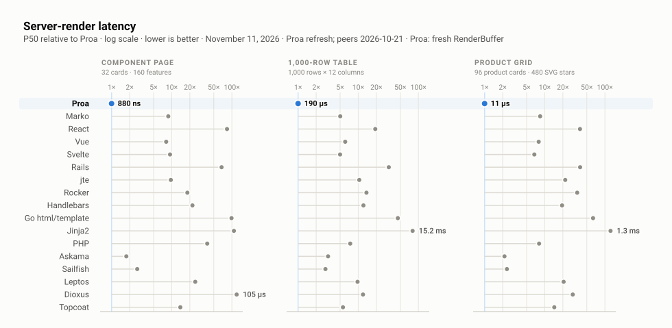
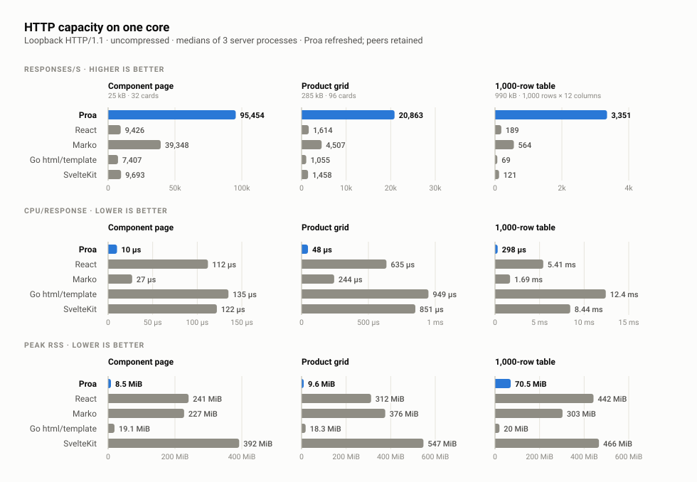
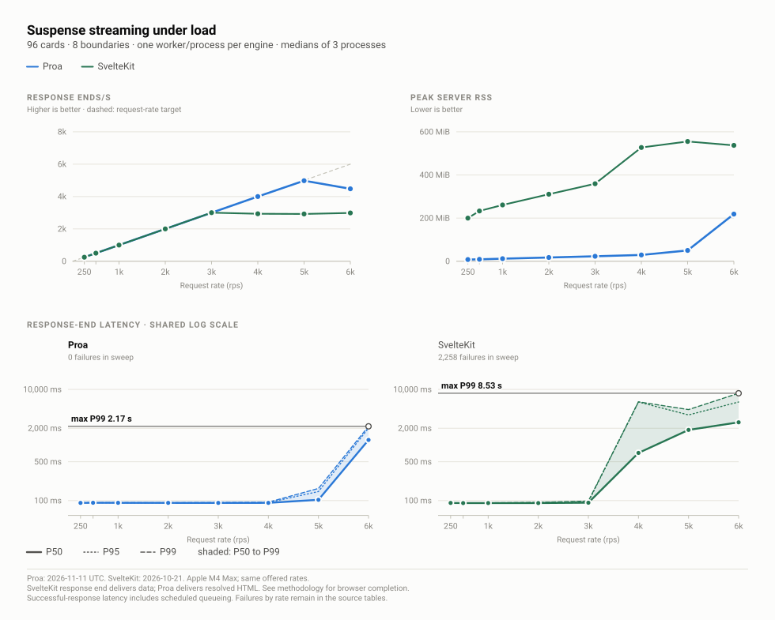
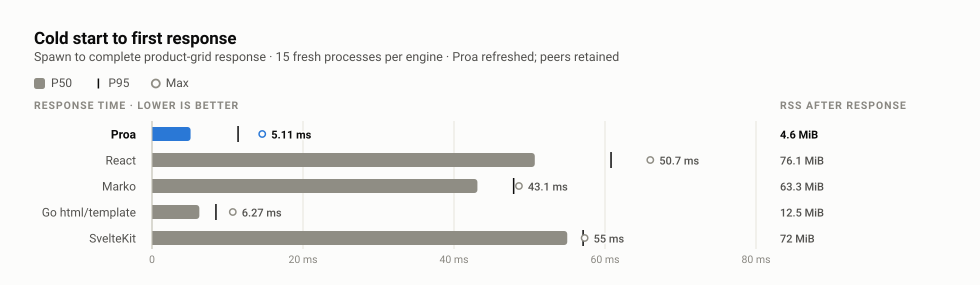

<div align="center">


# Proa

**The next era of web interfaces. Built in Rust.**

Proa is building the next generation of interface infrastructure for the web.
It enables you to create extremely fast, scalable applications and services in
Rust by bringing compiled components, streaming, data
loading, and fine-grained interactive islands into one framework.

[](proa_framework/proa_framework_axum/README.md)
[](proa_core)
[](proa_macros/README.md)
[](rsjs/README.md)
[](LICENSE)
[](https://x.com/drewhariri)
[](https://www.reddit.com/r/proa_rs/)

[**Get started**](https://proa.so/docs) ·
[**Explore apps**](https://proa.so/ecosystem/apps#reference-showcases) ·
[See the benchmarks](https://github.com/Proa-Labs/framework-benchmarks)

</div>

---

## A programming model for multiple interfaces

Proa's larger vision is one typed, compiled interface layer that produces the
right representation for whoever asks: complete HTML for people, targeted
behavior for browsers, and dense machine-readable output for agents.

This repository provides the compiled renderer, built-in render traits for
HTML and Markdown, browser interactivity, streaming, data loading, and framework
tooling. Other render targets can define their own rendering implementations,
whether for a format such as JSON or for a native rendering backend.

## Start in five minutes

Install the latest stable CLI through Cargo using a current Rust toolchain:

```bash
cargo install proa-cli --locked
```

Once installed, update with `proa update`, or preview the latest stable version
with `proa update --check`.

Follow the [quickstart](https://proa.so/docs) to install the styling tools,
create a site, edit its first route, and run Proa's checks.

## Your first page is a typed Rust component

Add the application-facing crate:

```toml
[dependencies]
proa = "0.4"
```

Markdown, streaming, the portable framework API, and RSJS are enabled by default.
Use `default-features = false` to select a smaller feature set.

Use `WebRenderSync` and `html_sync!` for the normal fast path:

```rust
use proa::{DataLoader, WebContext, WebRenderSync, WriteError};
use proa::html_sync;

struct Greeting {
    name: String,
}

impl<L: DataLoader> WebRenderSync<L> for Greeting {
    fn render(self, cx: &mut WebContext<L>) -> Result<(), WriteError> {
        html_sync! {
            <main class="mx-auto max-w-3xl px-6 py-16">
                <h1 class="text-4xl font-semibold">"Hello, "{self.name}</h1>
                <p class="mt-4 text-zinc-600">"Rendered by Proa."</p>
            </main>
        }
        .render(cx)
    }
}
```

The macro validates the template at compile time, consolidates adjacent static
markup, and preserves the correct escaping behavior for dynamic slots.

When a component genuinely needs to await work, switch to `WebRender` and
`html!`. Markdown follows the same split with `MdRenderSync` / `md_sync!` and
`MdRender` / `md!`.

## Add interactivity where it belongs

An RSJS island is still a normal server component. Add signals and event
handlers, and Proa emits the server-rendered HTML plus the JavaScript required
for that island:

```rust
use proa::{DataLoader, WebContext, WebRenderSync, WriteError};
use proa::html_sync;
use proa::rsjs::{rsjs, signal};

struct Counter {
    initial: i32,
}

#[rsjs(component, client)]
impl<L: DataLoader> WebRenderSync<L> for Counter {
    fn render(self, cx: &mut WebContext<L>) -> Result<(), WriteError> {
        let count = signal(self.initial);

        html_sync! {
            <button
                data-counter
                type="button"
                on_click={|_| count.update(|value| value + 1)}
            >
                "Count: "{count.get()}
            </button>
        }
        .render(cx)
    }
}
```

The browser starts from the HTML the server already rendered. It does not
re-run the server component tree to make the page interactive. See the
[RSJS guide](rsjs/README.md) for composition, queries, shared state, forms, and
current limitations.

## Markdown interfaces with MdRender

A component can expose both an HTML page and a Markdown document from the
same data. Give the `Greeting` component above a Markdown implementation:

```rust
use proa::{DataLoader, WebContext, MdRenderSync};
use proa::md_sync;

impl<L: DataLoader> MdRenderSync<L> for Greeting {
    fn render_md(self, cx: &mut WebContext<L>) -> Result<(), WriteError> {
        md_sync! { r###"
            # Hello, {self.name}

            Rendered by Proa.
            "###
        }
        .render_md(cx)
    }
}
```

`MdRenderSync` and `md_sync!` are the synchronous path. Use `MdRender` and
`md!` when a Markdown component needs to await work. Interpolated values are
escaped, and typed children compose into larger documents. Both renderers
use the same component data and define their own output.

For an existing synchronous HTML component, enable the core crate's
`html-to-markdown` feature and delegate with
`proa::to_markdown(self).render_md(cx)`. The adapter captures its HTML and
converts semantic elements to Markdown. It allocates during conversion;
handwritten Markdown remains the fast path and controls custom representations.
See the [HTML-to-Markdown example](proa_core/examples/html_to_markdown.rs).

See the [Markdown rendering guide](https://proa.so/docs/core/markdown) for
composition, async rendering, and serving Markdown alongside HTML.

## Technical Approach

We treat web rendering as a serialization problem, not a component-tree
reconstruction problem. A server should turn application state into useful HTML
as directly as possible: **emit as much HTML and as little JavaScript as
possible, as fast as possible.**

JavaScript is expensive. The browser must download it, parse it, compile it, and
execute it—often on the main thread. That is expensive on desktop and worse on
mobile CPUs; it can take [6-10x longer](https://github.com/GoogleChrome/lighthouse/blob/main/docs/throttling.md#benchmarking-cpu-power) to execute on lower tier android devices.
It also consumes memory and battery. Proa treats every byte of
client code as work that must justify itself. For more, see [Addy Osmani's "The Cost of JavaScript"](https://www.youtube.com/watch?v=X9eRLElSW1c)

## Benchmarks

Explore the interactive results at [frameworks.run](https://frameworks.run).
The [benchmark repository](https://github.com/Proa-Labs/framework-benchmarks)
contains the protocol, parity checks, source revisions, and raw captures.

**Proa refreshed November 11, 2026 at `bbbc968`.** The render-only, HTTP, and
cold-start comparisons use an Apple M4 Max. Only Proa was rerun; peer rows retain
their October 21 captures on the same machine. These are dated measurements of
specific workloads, rather than a simultaneous rerun or a claim about every app.

### Rendering

Proa's P50 was **0.875 µs** for the 32-card component page, **189.375 µs** for
the 1,000-row table, and **10.500 µs** for the 96-card product grid. This lane
includes allocation of a fresh owned `RenderBuffer` and excludes copying it to a
`String`. Routing, data loading, and HTTP are outside this render-only boundary.

[](assets/benchmarks/01-canonical-scoreboard.svg)

[Full renderer measurements and output contracts](https://github.com/Proa-Labs/framework-benchmarks/blob/main/scoreboard.md).

### Serving pages over HTTP

The product-grid capture measured **20,863 complete responses/s** and **9.6 MiB
peak RSS** for Proa. HTTP parsing, rendering, response serialization, allocation,
and transfer over loopback are included; compression is disabled.

[](assets/benchmarks/21-canonical-pages-http.svg)

[HTTP methodology and complete tables](https://github.com/Proa-Labs/framework-benchmarks/blob/main/http-capacity.md#canonical-pages-over-http-one-core-each).

### Streaming under load

This panel uses the Apple M4 Max Proa/SvelteKit captures: Proa from November 11
and SvelteKit from October 21, with one worker thread or process per server.
**Their HTTP completion boundaries differ:** SvelteKit delivers promised data
for the browser to render, while Proa delivers resolved HTML. Response-end
throughput and latency therefore do not measure the same completed browser work.

[](assets/benchmarks/20-suspense-load.svg)

[Streaming methodology and browser-completion measurements](https://github.com/Proa-Labs/framework-benchmarks/blob/main/sveltekit.md#browser-completion).

### Cold start to first response

The dated capture measured Proa at **5.11 ms P50** with **4.6 MiB RSS** after the
first complete product-grid response. Each engine used 15 fresh processes after
two filesystem-cache warmups. This includes process startup and the first render;
it excludes installation and build time. Other work was active on the shared
host, so rerun on an idle machine before using the absolute times for planning.

[](assets/benchmarks/22-cold-start.svg)

[Cold-start method and capture conditions](https://github.com/Proa-Labs/framework-benchmarks/blob/main/http-capacity.md#cold-start-to-first-response).
[Chart provenance and refresh instructions](docs/asset-provenance.md#benchmark-charts).

## Proa in production

- [latency.so](https://latency.so): a server-side rendering speed
  leaderboard, server-rendered with Proa.

## Explore the project

| If you want to… | Start here |
|---|---|
| Build your first Proa site | [Getting started](https://proa.so/docs) |
| Understand the benchmark claims | [Benchmarks](#benchmarks) and the [full evidence repository](https://github.com/Proa-Labs/framework-benchmarks) |
| Author server-rendered components | [`proa_core`](proa_core) and [`proa_macros`](proa_macros/README.md) |
| Build interactive islands | [RSJS](rsjs/README.md) |
| Load data and stream independent boundaries | [`proa_stream`](proa_stream) and the [data-loading guide](https://proa.so/docs/framework/data-loading) |
| Integrate routing, security, and Axum | [`proa_framework_axum`](proa_framework/proa_framework_axum/README.md) |
| Adapt Proa to another HTTP server or runtime | [`proa_framework_core`](proa_framework/proa_framework_core/README.md) |
| Compile documentation and self-hosted fonts | [`proa_docs`](proa_docs) and [`proa_fonts`](proa_fonts) |
| Embed rendering in an existing service | [FFI guide](https://proa.so/docs/ffi) |
| Contribute to Proa | [Contributing guide](CONTRIBUTING.md) |
| Give a coding agent project context | [Agent authoring guide](docs/agent/index.md) |

## Repository development

Prerequisites:

- Rust 1.93.0 or newer
- Python 3 for repository lint scripts
- Node.js 22 or newer for browser conformance tests and JavaScript comparison
  engines

Run the workspace checks from the repository root:

```bash
cargo fmt --all
cargo check --workspace --all-targets
cargo test --workspace --no-fail-fast
python3 scripts/proa_perf_lint.py
```

Run the marketing site and documentation locally with:

```bash
cargo proa run -p proa_marketing --bin proa_marketing
```

This repository contains the compiled-template engine and its first-party
framework, tooling, examples, and RSJS compiler. Runtime templates and the
`proa_ui` component library are downstream projects with independent release
processes.

Security issues should be reported privately according to
[`SECURITY.md`](SECURITY.md). Generated and captured assets are documented in
[`GENERATED.md`](GENERATED.md).

## License

Proa is licensed under the Apache License, Version 2.0. See
[`LICENSE`](LICENSE), copyright 2026 Proa Labs, Inc.

Commercial use, including inside closed-source products, is permitted with no
separate agreement. See [`LICENSING.md`](LICENSING.md) for details or contact
`legal@proa.so`. Third-party attributions are collected in
[`THIRD_PARTY_NOTICES.md`](THIRD_PARTY_NOTICES.md).
