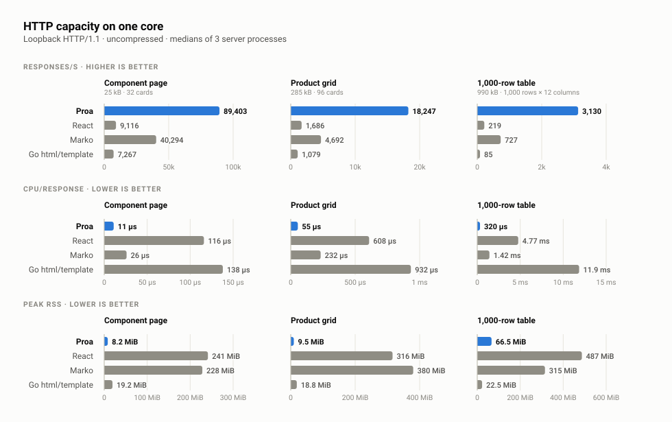
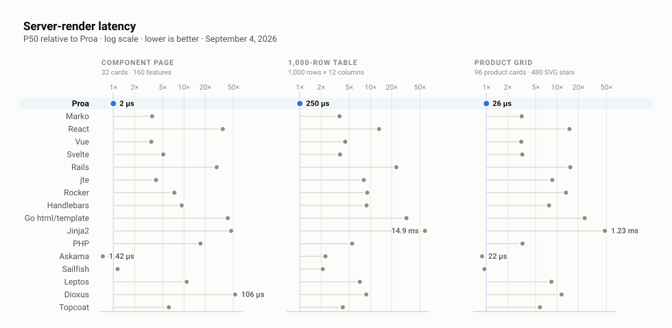
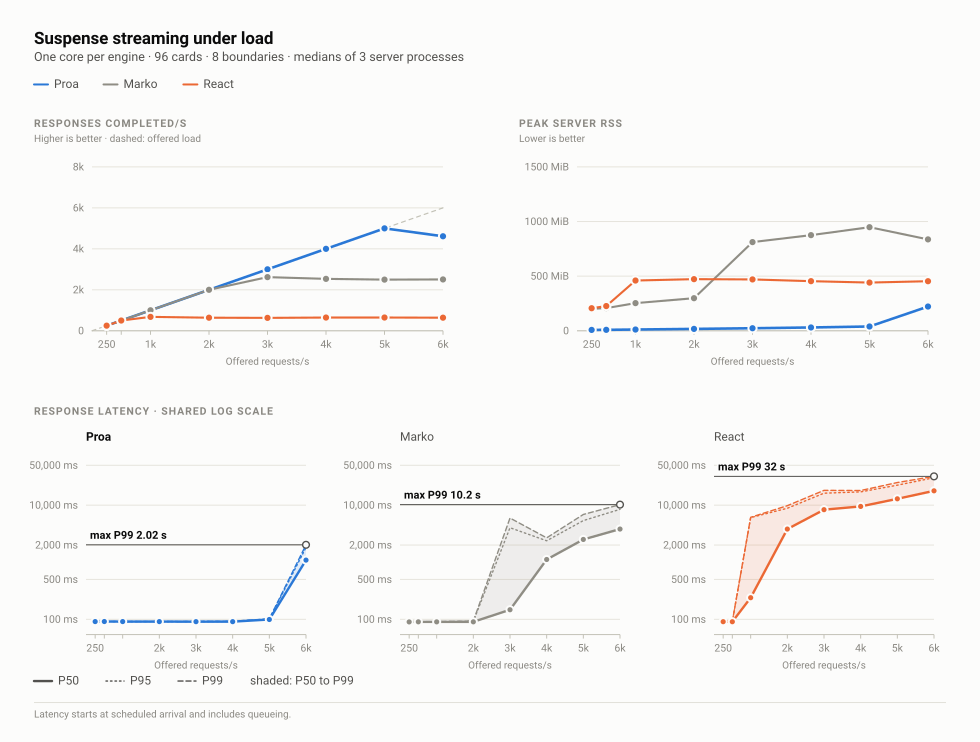
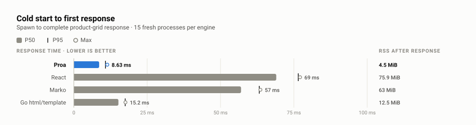

<div align="center">


# Proa

Proa is building the next generation of interface infrastructure for the web.
It enables you to create extremely fast, scalable applications and services in
Rust by bringing compiled components, streaming, data
loading, and fine-grained interactive islands into one framework.

[](proa_framework/proa_framework_axum/README.md)
[](proa_core)
[](proa_macros/README.md)
[](rsjs/README.md)
[](LICENSE)
[](https://x.com/drewhariri)
[](https://www.reddit.com/r/proa_rs/)

[**Get started**](https://proa.so/docs) ·
[**Explore apps**](https://proa.so/ecosystem/apps#reference-showcases) ·
[See the benchmarks](https://github.com/Proa-Labs/proa-benchmarks)

</div>

---

## Next-generation interface infrastructure

The web's interface layer was designed around a person opening one page at a
time in a browser. The next web must also serve crawlers and software agents
that read and act across hundreds of interfaces in parallel, at massive scale.

Proa's larger vision is one typed, compiled interface layer that produces the
right representation for whoever asks: complete HTML for people, targeted
behavior for browsers, and dense machine-readable output for agents.

This repository is the foundation of that vision: a high-performance server
renderer, a typed component model, fine-grained browser interactivity,
streaming, data loading, and the framework machinery needed to run them in
production.

## Start in five minutes

Install the latest stable CLI through Cargo using a current Rust toolchain:

```bash
cargo install proa-cli --locked
```

Follow the [quickstart](https://proa.so/docs) to install the styling tools,
create a site, edit its first route, and run Proa's checks.

## Your first page is a typed Rust component

Use `WebRenderSync` and `html_sync!` for the normal fast path:

```rust
use proa_core::{DataLoader, WebContext, WebRenderSync, WriteError};
use proa_macros::html_sync;

struct Greeting {
    name: String,
}

impl<L: DataLoader> WebRenderSync<L> for Greeting {
    fn render(self, cx: &mut WebContext<L>) -> Result<(), WriteError> {
        html_sync! {
            <main class="mx-auto max-w-3xl px-6 py-16">
                <h1 class="text-4xl font-semibold">"Hello, "{self.name}</h1>
                <p class="mt-4 text-zinc-600">"Rendered by Proa."</p>
            </main>
        }
        .render(cx)
    }
}
```

The macro validates the template at compile time, consolidates adjacent static
markup, and preserves the correct escaping behavior for dynamic slots.

When a component genuinely needs to await work, switch to `WebRender` and
`html!`. Markdown follows the same split with `MdRenderSync` / `md_sync!` and
`MdRender` / `md!`.

## Add interactivity where it belongs

An RSJS island is still a normal server component. Add signals and event
handlers, and Proa emits the server-rendered HTML plus the JavaScript required
for that island:

```rust
use proa_core::{DataLoader, WebContext, WebRenderSync, WriteError};
use proa_macros::html_sync;
use rsjs::{rsjs, signal};

struct Counter {
    initial: i32,
}

#[rsjs(component, client)]
impl<L: DataLoader> WebRenderSync<L> for Counter {
    fn render(self, cx: &mut WebContext<L>) -> Result<(), WriteError> {
        let count = signal(self.initial);

        html_sync! {
            <button
                data-counter
                type="button"
                on_click={|_| count.update(|value| value + 1)}
            >
                "Count: "{count.get()}
            </button>
        }
        .render(cx)
    }
}
```

The browser starts from the HTML the server already rendered. It does not
re-run the server component tree to make the page interactive. See the
[RSJS guide](rsjs/README.md) for composition, queries, shared state, forms, and
current limitations.

## Markdown interfaces with MdRender

A component can render Markdown for agents as well as HTML for people. Give
the `Greeting` component above a Markdown implementation:

```rust
use proa_core::{DataLoader, WebContext, MdRenderSync};
use proa_macros::md_sync;

impl<L: DataLoader> MdRenderSync<L> for Greeting {
    fn render_md(self, cx: &mut WebContext<L>) -> Result<(), WriteError> {
        md_sync! { r###"
            # Hello, {self.name}

            Rendered by Proa.
            "###
        }
        .render_md(cx)
    }
}
```

`MdRenderSync` and `md_sync!` are the synchronous path. Use `MdRender` and
`md!` when a Markdown component needs to await work. Interpolated values are
escaped, and typed children compose into larger documents. Both renderers
use the same component data and define their own output.

For an existing synchronous HTML component, enable the core crate's
`html-to-markdown` feature and delegate with
`proa_core::to_markdown(self).render_md(cx)`. The adapter captures its HTML and
converts semantic elements to Markdown. It allocates during conversion;
handwritten Markdown remains the fast path and controls custom representations.
See the [HTML-to-Markdown example](proa_core/examples/html_to_markdown.rs).

See the [Markdown rendering guide](https://proa.so/docs/core/markdown) for
composition, async rendering, and serving Markdown alongside HTML.

## Technical Approach

We treat web rendering as a serialization problem, not a component-tree
reconstruction problem. A server should turn application state into useful HTML
as directly as possible: **emit as much HTML and as little JavaScript as
possible, as fast as possible.**

JavaScript is expensive. The browser must download it, parse it, compile it, and
execute it—often on the main thread. That is expensive on desktop and worse on
mobile CPUs; it can take [6-10x longer](https://github.com/GoogleChrome/lighthouse/blob/main/docs/throttling.md#benchmarking-cpu-power) to execute on lower tier android devices.
It also consumes memory and battery. Proa treats every byte of
client code as work that must justify itself. For more, see [Addy Osmani's "The Cost of JavaScript"](https://www.youtube.com/watch?v=X9eRLElSW1c)

## Benchmarks

For more benchmarks, see
[Proa-Labs/proa-benchmarks](https://github.com/Proa-Labs/proa-benchmarks).

[](assets/benchmarks/21-canonical-pages-http.svg)

[](assets/benchmarks/01-canonical-scoreboard.svg)


[](assets/benchmarks/20-suspense-load.svg)

**How fast does a fresh process answer?** Spawn to first complete response, the
cost of every autoscaling event and cold instance: Proa answered in 8.63 ms
holding 4.5 MiB, against 69.0 ms and 75.9 MiB for React, 57.0 ms and 63.0 MiB
for Marko, and 15.2 ms and 12.5 MiB for Go.

[](assets/benchmarks/22-cold-start.svg)

The parity gate, the one-core rule, the load generator's self-checks, what is
deliberately left outside each measurement, every raw JSON capture, and the
commands to reproduce all of it on your own hardware are documented in
[Proa-Labs/proa-benchmarks](https://github.com/Proa-Labs/proa-benchmarks).

## Proa in production

- [latency.so](https://latency.so): a server-side rendering speed
  leaderboard, server-rendered with Proa.

## Explore the project

| If you want to… | Start here |
|---|---|
| Build your first Proa site | [Getting started](https://proa.so/docs) |
| Understand the benchmark claims | [Benchmarks](#benchmarks) and the [full evidence repository](https://github.com/Proa-Labs/proa-benchmarks) |
| Author server-rendered components | [`proa_core`](proa_core) and [`proa_macros`](proa_macros/README.md) |
| Build interactive islands | [RSJS](rsjs/README.md) |
| Load data and stream independent boundaries | [`proa_stream`](proa_stream) and the [data-loading guide](https://proa.so/docs/framework/data-loading) |
| Integrate routing, security, and Axum | [`proa_framework_axum`](proa_framework/proa_framework_axum/README.md) |
| Adapt Proa to another HTTP server or runtime | [`proa_framework_core`](proa_framework/proa_framework_core/README.md) |
| Compile documentation and self-hosted fonts | [`proa_docs`](proa_docs) and [`proa_fonts`](proa_fonts) |
| Embed rendering in an existing service | [FFI guide](https://proa.so/docs/ffi) |
| Contribute to Proa | [Contributing guide](CONTRIBUTING.md) |
| Give a coding agent project context | [Agent authoring guide](docs/agent/index.md) |

## Repository development

Prerequisites:

- Rust 1.93.0 or newer
- Python 3 for repository lint scripts
- Node.js 22 or newer for browser conformance tests and JavaScript comparison
  engines

Run the workspace checks from the repository root:

```bash
cargo fmt --all
cargo check --workspace --all-targets
cargo test --workspace --no-fail-fast
python3 scripts/proa_perf_lint.py
```

Run the marketing site and documentation locally with:

```bash
cargo run -p proa_marketing
```

This repository contains the compiled-template engine and its first-party
framework, tooling, examples, and RSJS compiler. Runtime templates and the
`proa_ui` component library are downstream projects with independent release
processes.

Security issues should be reported privately according to
[`SECURITY.md`](SECURITY.md). Generated and captured assets are documented in
[`GENERATED.md`](GENERATED.md).

## License

Proa is licensed under the Apache License, Version 2.0. See
[`LICENSE`](LICENSE), copyright 2026 Proa Labs, Inc.

Commercial use, including inside closed-source products, is permitted with no
separate agreement. See [`LICENSING.md`](LICENSING.md) for details or contact
`legal@proa.so`. Third-party attributions are collected in
[`THIRD_PARTY_NOTICES.md`](THIRD_PARTY_NOTICES.md).
