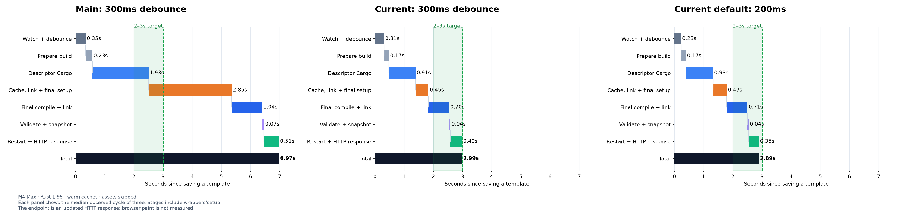
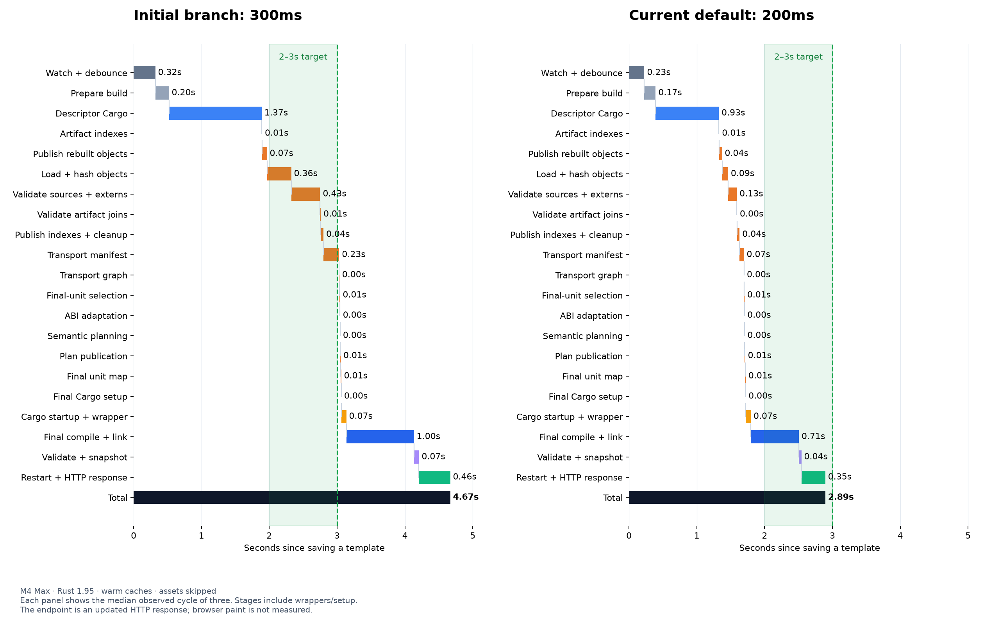

# Pizza: reaching the 2–3 second rebuild target

The target is a warmed ordinary Rust rebuild reaching a changed HTTP response
in approximately 2–3 seconds. The copied Pizza example uses its ordinary dev
profile, incremental descriptor/final builds, and a release-built CLI. Assets
are skipped as in the original benchmark; browser paint is outside this metric.
No hot-static opt-in or reduced-debug profile is used.

## Verified default results

| Ordinary edit, normal dev profile, actual CLI defaults | Median | Samples |
| --- | ---: | --- |
| Template text inside `html_sync!` | 2.895s | 2.837, 2.960, 2.895s |
| Rust function body consumed by a typed template slot | 2.908s | 2.981, 2.900, 2.908s |

Both cases perform the full descriptor and final compilation pipeline. These
results meet the 2–3s target for these warm small edits on this machine. The
pre-default checkpoint using 300ms measured 3.021s; the final same-settings
run measured 2.985s (3.007, 2.963, 2.985s). Changing the default is recorded
separately from those build improvements.

The function trial moves the title into a small ordinary Rust helper, then
changes only that helper's returned string. Its exact fixture transformation is
[pizza-function-edit.patch](evidence/pizza-function-edit.patch). Both HTTP trials
restore the copied example afterward. Raw events, commands, stage timings, and
all samples are retained in [evidence/](evidence/).
[Provenance](evidence/pizza-target-metadata.json) records the code commit and binary
digests; [the software-control patch](evidence/pizza-software-timing-control.patch)
reproduces its instrumentation on the earlier branch checkpoint.





## What the finer waterfall showed

The initial branch measured 4.854s; a fresh, instrumented run of that same
pipeline measured 4.668s. Its aggregate cache/link/setup bucket was dominated
by object hashing (about 358ms), observed input/extern validation (425ms), and
transport-manifest construction (227ms). Semantic planning was below 1ms.

The CLI was using sha2 0.10's portable software backend on Apple Silicon.
[sha2 0.11's documented default backend](https://docs.rs/sha2/0.11.0/sha2/#backends)
runtime-detects AArch64 SHA extensions and falls back to software on unsupported
CPUs. The CLI now uses that implementation for compiler artifacts, wrapper
fingerprints, cache publications, and transport validation. Other workspace
consumers keep their existing sha2 version. No global target features or native
assembly feature is enabled.

All hash domains and serialized formats are preserved. A compatibility test
compares the existing implementation against file hashing, paired hash domains,
and retained object snapshots at SHA-block and 64KiB I/O boundaries. Cache
validation still reads and hashes current bytes on every invocation.

Accelerated hashing alone measured 3.103s with the original 300ms quiet window.
Independent cached units now validate their full observed input sets in parallel;
results are collected in canonical unit order to preserve deterministic errors.
The restart loop polls for exit every 5ms instead of 100ms, retaining the full
two-second TERM grace before KILL. Together these measured 3.021s at 300ms.

## Watcher defaults

The default quiet window is now 200ms. New observed bytes reset the full window;
a fresh snapshot is required before any build starts. Pending windows schedule
the next poll at the deadline if it is earlier than the ordinary 100ms poll.
The previous window remains available with `proa dev --debounce-ms 300` (or a
longer value for workflows with longer write bursts).

These changes apply to existing and newly scaffolded applications through the
CLI. `proa new` already inherits Cargo's incremental dev compilation default,
so generated Cargo manifests need no incremental/generation flags.

## Diagnostics and reproduction

Set `PROA_BUILD_TIMINGS=1` on `proa dev` to log elapsed successful pipeline stages
on stderr. The latency probe retains those events and timing values. The plotter
can expand the aggregate cache/setup stage with `--detailed`; durations are wall
clock measurements, not a CPU profile of individual compiler functions.

```sh
cargo build -p proa-cli --bin cargo-proa --release
PROA_BUILD_TIMINGS=1 python3 scripts/dev_latency_probe.py \
  --fixture /tmp/proa-dev-perf-pizza --cli target/release/cargo-proa \
  --source src/lib.rs --url-path / --profile dev
```

Omitting `--debounce-ms` measures the CLI's actual default. Each comparison is
serialized, uses three warmed edits, and checks the changed marker over HTTP.
The initial watcher startup/cold compilation is excluded.

## Remaining architecture work

The pipeline still performs descriptor and final compilations. Global plan
changes can still rebuild otherwise unchanged RSJS crates. Stable owner/site
identities and transitive per-unit plan projections remain the next architecture
investigation described in [INVALIDATION.md](INVALIDATION.md). This hashing and
watcher work does not claim to complete that redesign.

## Validation

- Workspace: `cargo check --workspace --all-targets --offline` passed.
- CLI library: 680 tests, including legacy/new digest compatibility and TERM/KILL grace behavior.
- Descriptor wrapper/cache integrations: 11/12 tests; final compilation: 4; pipeline: 3.
- Lifecycle dev integration: 1; default and Rust-function HTTP performance trials: all six changed responses verified.
- Rust formatting, Python syntax checks, and diff whitespace checks passed.

The whole-workspace test suite and non-macOS performance were not tested in this
follow-up. Architecture/payload identities are unchanged; the existing global
plan attestation and cache corruption checks remain active.
