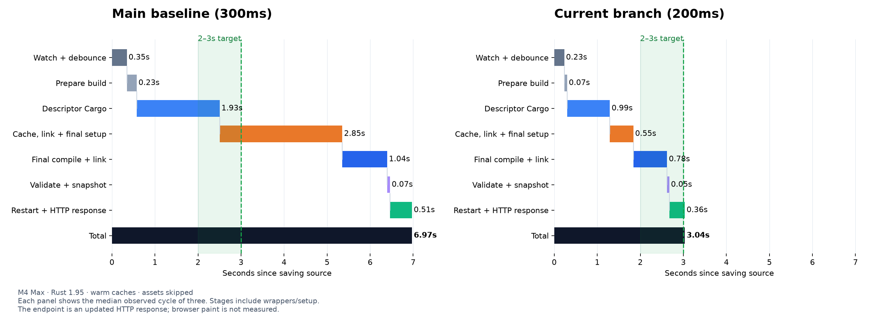
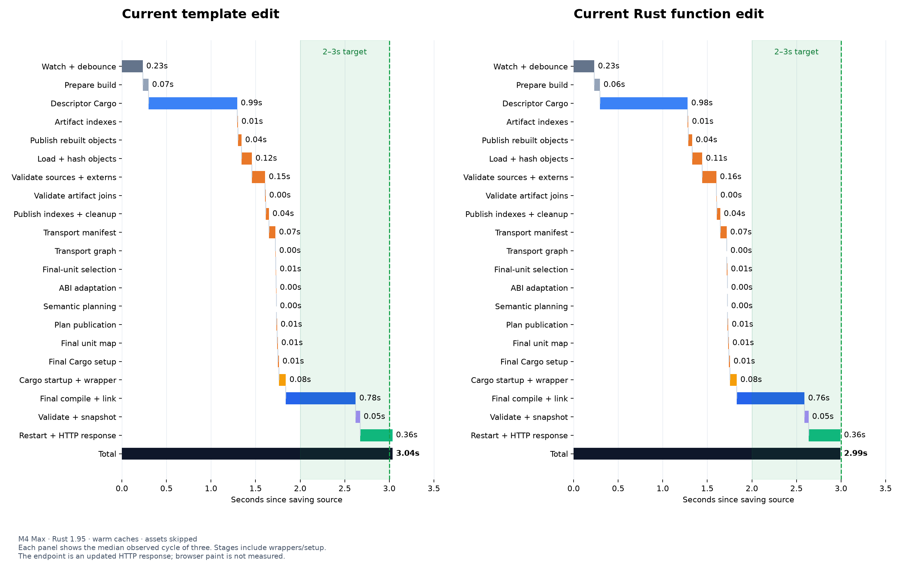
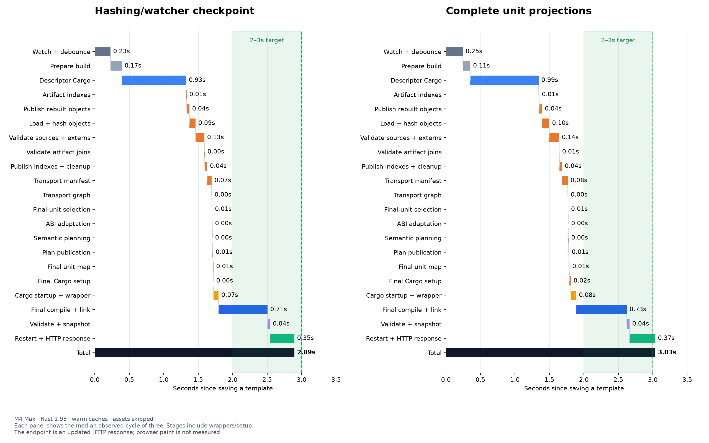

# Pizza: reaching the 2–3 second rebuild target

The target is a warmed ordinary Rust rebuild reaching a changed HTTP response
in approximately 2–3 seconds. The copied Pizza example uses its ordinary dev
profile, incremental descriptor/final builds, and a release-built CLI. Assets
are skipped as in the original benchmark; browser paint is outside this metric.
No hot-static opt-in or reduced-debug profile is used.

## Latest complete-architecture results

On code commit `b8f4fcf`, after verified unit projections, process-local derivation
reuse, parallel preparation queries, and warm wrapper snapshot reuse:

| Ordinary edit, actual defaults | Median | Samples |
| --- | ---: | --- |
| Template text | 3.035s | 2.943, 3.036, 3.035s |
| Rust function body | 2.993s | 3.050, 2.967, 2.993s |

The target remains 2–3s. The function median is inside it, but the template
median is slightly above it and both trials contain samples above 3s. This is
approximately 3s, without reliable margin below the upper bound. The original
main/default template baseline was 6.974s with a 300ms quiet window; the current
CLI default is 200ms. The graphs label that policy difference explicitly.

[Latest template events](evidence/pizza-wrapper-reuse-template-watch.json),
[function events](evidence/pizza-wrapper-reuse-function-watch.json), and
[provenance](evidence/pizza-wrapper-reuse-metadata.json) preserve every sample.





The median observed cycles still spend about 1.8s in descriptor/final Cargo,
0.5s in cache validation and planning, and 0.36s restarting and serving HTTP.
Semantic planning itself is below 1ms. The next investigation is repeated input
hashing/validation within a cycle and server startup, preserving current-byte
validation and exact artifact publication. No latency benefit from those future
changes is assumed.

## Hashing/watcher checkpoint results

| Ordinary edit, normal dev profile, actual CLI defaults | Median | Samples |
| --- | ---: | --- |
| Template text inside `html_sync!` | 2.895s | 2.837, 2.960, 2.895s |
| Rust function body consumed by a typed template slot | 2.908s | 2.981, 2.900, 2.908s |

Both cases perform the full descriptor and final compilation pipeline. These
results meet the 2–3s target for these warm small edits on this machine. The
pre-default checkpoint using 300ms measured 3.021s; the final same-settings
run measured 2.985s (3.007, 2.963, 2.985s). Changing the default is recorded
separately from those build improvements.

The function trial moves the title into a small ordinary Rust helper, then
changes only that helper's returned string. Its exact fixture transformation is
[pizza-function-edit.patch](evidence/pizza-function-edit.patch). Both HTTP trials
restore the copied example afterward. Raw events, commands, stage timings, and
all samples are retained in [evidence/](evidence/).
[Provenance](evidence/pizza-target-metadata.json) records the code commit and binary
digests; [the software-control patch](evidence/pizza-software-timing-control.patch)
reproduces its instrumentation on the earlier branch checkpoint.


## What the finer waterfall showed

The initial branch measured 4.854s; a fresh, instrumented run of that same
pipeline measured 4.668s. Its aggregate cache/link/setup bucket was dominated
by object hashing (about 358ms), observed input/extern validation (425ms), and
transport-manifest construction (227ms). Semantic planning was below 1ms.

The CLI was using sha2 0.10's portable software backend on Apple Silicon.
[sha2 0.11's documented default backend](https://docs.rs/sha2/0.11.0/sha2/#backends)
runtime-detects AArch64 SHA extensions and falls back to software on unsupported
CPUs. The CLI now uses that implementation for compiler artifacts, wrapper
fingerprints, cache publications, and transport validation. Other workspace
consumers keep their existing sha2 version. No global target features or native
assembly feature is enabled.

All hash domains and serialized formats are preserved. A compatibility test
compares the existing implementation against file hashing, paired hash domains,
and retained object snapshots at SHA-block and 64KiB I/O boundaries. Cache
validation still reads and hashes current bytes on every invocation.

Accelerated hashing alone measured 3.103s with the original 300ms quiet window.
Independent cached units now validate their full observed input sets in parallel;
results are collected in canonical unit order to preserve deterministic errors.
The restart loop polls for exit every 5ms instead of 100ms, retaining the full
two-second TERM grace before KILL. Together these measured 3.021s at 300ms.

## Watcher defaults

The default quiet window is now 200ms. New observed bytes reset the full window;
a fresh snapshot is required before any build starts. Pending windows schedule
the next poll at the deadline if it is earlier than the ordinary 100ms poll.
The previous window remains available with `proa dev --debounce-ms 300` (or a
longer value for workflows with longer write bursts).

These changes apply to existing and newly scaffolded applications through the
CLI. `proa new` already inherits Cargo's incremental dev compilation default,
so generated Cargo manifests need no incremental/generation flags.

## Diagnostics and reproduction

Set `PROA_BUILD_TIMINGS=1` on `proa dev` to log elapsed successful pipeline stages
on stderr. The latency probe retains those events and timing values. The plotter
can expand the aggregate cache/setup stage with `--detailed`; durations are wall
clock measurements, not a CPU profile of individual compiler functions.

```sh
cargo build -p proa-cli --bin cargo-proa --release
PROA_BUILD_TIMINGS=1 python3 scripts/dev_latency_probe.py \
  --fixture /tmp/proa-dev-perf-pizza --cli target/release/cargo-proa \
  --source src/lib.rs --url-path / --profile dev
```

Omitting `--debounce-ms` measures the CLI's actual default. Each comparison is
serialized, uses three warmed edits, and checks the changed marker over HTTP.
The initial watcher startup/cold compilation is excluded.

## Architecture follow-up

The timings above describe the hashing/watcher checkpoint. Subsequent work
implements stable runtime coordinates, fragment/owner generations, and complete
unit projections, with actual unrelated-crate reuse and shared helper/child
invalidation verified in [INVALIDATION.md](INVALIDATION.md). The pipeline still
performs descriptor and final compilations. The first rebenchmark of the complete architecture (`46bfb48`) measured:

| Ordinary edit, actual defaults | Median | Samples |
| --- | ---: | --- |
| Template text | 3.035s | 3.035, 3.069, 3.003s |
| Rust function body | 3.037s | 3.037, 3.042, 2.937s |

This checkpoint is slightly above the target. Pizza puts its components in one
Cargo unit, so preserving unrelated dependency crates does not substantially
reduce its own compilation. The median stage values show approximately 20ms
more object loading/hashing, 25ms more observed-input validation, 11ms more final
Cargo setup, and 37ms more final Cargo execution than the earlier checkpoint.
These are wall-clock differences across three-sample runs; they do not isolate
one cause for the full 140ms change. Repeated projection derivation is now reused within a compiler process after
fresh full-plan and projection checks. The rebenchmark measured 2.993s template
(2.961, 2.993, 3.047s) and 3.033s function edits (3.020, 3.049, 3.033s).
That remains at the target boundary, and the stage timings do not establish a
large latency benefit from the derivation cache.

[Cache-trial template events](evidence/pizza-projection-cache-template-watch.json),
[function events](evidence/pizza-projection-cache-function-watch.json), and
[provenance](evidence/pizza-projection-cache-metadata.json) retain these trials.
The cache change passed all 437 macro library tests and the 15 existing plus one
new real Cargo/runtime integration tests.

[Raw template events](evidence/pizza-unit-projection-template-watch.json),
[function events](evidence/pizza-unit-projection-function-watch.json), and
[provenance](evidence/pizza-unit-projection-metadata.json) retain both outcomes.



The next preparation experiment (`33d5d08`) runs Cargo metadata, Cargo version,
and rustc version queries concurrently, while still querying them afresh each
cycle. It measured 3.088s template (3.766, 3.005, 3.088s) and 3.017s function
edits (3.017, 2.991, 3.048s). The slow 3.766s sample is retained: its descriptor
stage took 1.640s compared with 0.96–0.97s in the other two samples. This trial
does not establish an overall latency gain.

The finer preparation diagnostics showed another 40–50ms spent snapshotting
and fingerprinting the CLI wrapper. Its warm reuse path now checks fresh source
and destination bytes and permissions, validates the executable dependency
contract, and reuses an identical existing snapshot without writing and syncing
an identical temporary file. A miss retains the original copy and atomic
publication path. Same-size snapshot corruption is rejected, and a changed
wrapper still creates a new cache namespace. CLI library and lifecycle tests
passed. The rebenchmark above measured a median wrapper preparation stage
of 30.151ms for template edits and 29.106ms for function edits, compared with
47.222/42.458ms in the preceding preparation trial. This stage improvement
does not establish a reliable whole-cycle gain by itself.

[Preparation template events](evidence/pizza-parallel-preparation-template-watch.json),
[function events](evidence/pizza-parallel-preparation-function-watch.json), and
[provenance](evidence/pizza-parallel-preparation-metadata.json) retain this control.


## Validation

The complete architecture passed 680 CLI, 311 IR, and 437 macro library tests,
15 existing Cargo/runtime integrations, the new six-build unit reuse integration,
and lifecycle dev verification. The latest wrapper changes reran all 680 CLI
tests and lifecycle dev; unchanged IR/macro/runtime checks were not repeated.
The broader workspace check passed at the unit projection checkpoint. The
latest six Pizza HTTP responses were all verified, and fixture source was restored.

Earlier hashing/watcher checkpoint checks:

- Workspace: `cargo check --workspace --all-targets --offline` passed.
- CLI library: 680 tests, including legacy/new digest compatibility and TERM/KILL grace behavior.
- Descriptor wrapper/cache integrations: 11/12 tests; final compilation: 4; pipeline: 3.
- Lifecycle dev integration: 1; default and Rust-function HTTP performance trials: all six changed responses verified.
- Rust formatting, Python syntax checks, and diff whitespace checks passed.

The whole-workspace test suite and non-macOS performance were not tested in this
follow-up. The existing global plan attestation and cache corruption checks remain active.
The subsequent runtime and asset identity changes are described in
[INVALIDATION.md](INVALIDATION.md).
