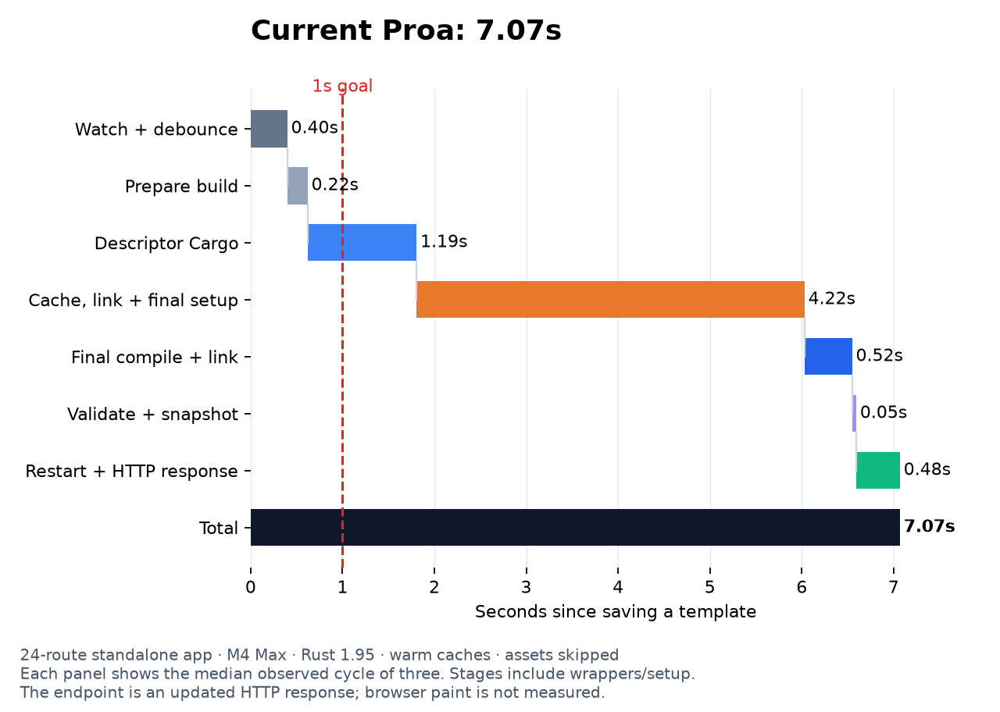
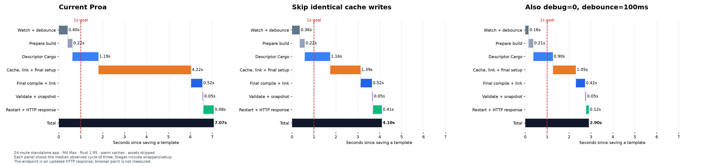

# Consumer project compile-time investigation

Measured on 2026-10-03 against checkout `c3cbaee`, using an Apple M4 Max,
128 GiB RAM, macOS 26.5.2, and Rust/Cargo 1.95.0.

The biggest measured opportunity is in Proa's dev orchestration: it rewrites
and durably flushes unchanged descriptor-cache indexes on every cycle. This
costs several seconds even when Cargo recompiles nothing. After that, the
descriptor pass's nonincremental code generation and the two-pass architecture
are the next obstacles to a one-second update.

## Incremental compilation: learning and performance expectations

There are two different kinds of reuse. Cargo can decide that a whole crate is
fresh and avoid invoking rustc. If a crate must be recompiled, rustc incremental
compilation can reuse internal computations and generated code whose inputs
remain valid. Our warm edit already reuses 235/236 artifacts in each pass;
the opportunity is to make rebuilding the changed unit cheaper and reduce
Proa work around those passes.

Read the [Cargo profile settings](https://doc.rust-lang.org/cargo/reference/profiles.html#incremental)
for practical controls, then the compiler guide's
[incremental compilation overview](https://rustc-dev-guide.rust-lang.org/queries/incremental-compilation.html)
and [implementation details](https://rustc-dev-guide.rust-lang.org/queries/incremental-compilation-in-detail.html).
The overview explains how dependency tracking and result fingerprints allow
unchanged compiler computations to be reused, even when an input changed but
the computed result stayed the same. This is finer-grained than caching an
entire crate or rebuilding only a modified file.

For this measured workload, expect roughly **4 seconds** after the validated
cache-publication fix under the original settings, or roughly **3 seconds**
with the measured reduced-debug/debounce settings. These expectations are
anchored in prototype observations; actual downstream assets and application
behavior may change the totals.

After duplicate-work reductions and incremental descriptor collection, use
**2–3 seconds** as a provisional planning expectation for a similar warm edit,
not a validated result. In the optimized waterfall, the descriptor Cargo stage
is 0.90s: halving that stage alone would move 2.90s to approximately 2.45s.
The 1.05s cache/link/setup stage is another opportunity. Measure the benefits
independently; their savings need not add linearly. There is no measured basis
yet for promising sub-second complete Rust rebuild/restart cycles. Larger
consumer crates may have more incremental-compilation upside than this fixture.

## Next investigation sequence

1. **Confirm the actual application's waterfall and finish unchanged-cache
   publication.** Use the downstream site/app, then validate the production
   implementation against corruption, interruption, and concurrent access.
   Compare at the same debug/debounce settings; test reduced debug information
   and shorter debounce separately as optional workflow choices.
2. **Remove repeated object reads, hashing, and descriptor extraction.** Reuse
   validated data within the retained cache lease and preserve exact input
   freshness. Track unchanged-cycle latency as well as edited builds.
3. **Prototype multi-object descriptor collection with incremental codegen.**
   Preserve unused witnesses, relocations, and complete outputs across partial
   rebuilds. Measure object-extraction cost as well as compiler savings.
4. **Narrow final-plan invalidation to affected units.** Add a multi-crate
   consumer case that proves unaffected RSJS units stay reusable, while all
   actual cross-unit dependencies and root attestation remain correct.
5. **Compare upstream compiler configurations.** Use current stable and a
   pinned nightly, isolate the next-solver change on that nightly, and evaluate
   supported parallel-frontend/Cranelift configurations. Compatibility smoke
   checks can run earlier; the full latency comparison should use the improved
   pipeline so framework overhead does not obscure the effect.
6. **Decide the scope of template hot updates from the remaining waterfall.**
   Pursue a narrow static-edit mechanism if common template edits still exceed
   the desired budget. Continue validated Rust builds for incompatible edits.

## What was measured

The probes create standalone consumer applications outside this workspace,
with their own `[workspace]`, profiles, lockfile, and Cargo target directory.
Only their library dependencies point at this checkout. They do not inherit
the framework workspace's build profiles. The CLI itself is release-built.

Each application has 24 Axum routes, each rendering a Proa `html_sync!` page
with eight cards and dynamic text/numbers. The island configuration also
renders a counter using `#[rsjs(component, client)]`. This exercises real
descriptor collection, semantic linking, final macro expansion, and executable
activation. The fixture is a compile/restart workload, not a complete browser
application: it does not install the counter's browser bootstrap/assets.

Warm edits alternate a literal in one page. A separate handler edit changes
counter arithmetic. Three edits are measured per configuration; the reported
number is their median. Initial warmup/cold builds are excluded. An unchanged
cycle is measured separately. Configured asset commands, database setup, docs
generation, and external services are absent, so these numbers do not diagnose
every part of an existing site's eight-second cycle.

There are two distinct endpoints:

- **Build-only:** launch a one-shot consumer process that exits immediately,
  including Proa/Cargo orchestration and process startup. Watcher debounce and
  browser reload are excluded.
- **Save-to-response:** run the real `proa dev` watcher, save a source file,
  and poll until the changed page is served over HTTP. This includes debounce,
  compilation, cache work, executable activation, and server restart. Browser
  navigation, hydration, and paint are excluded. HTTP polling adds up to one
  polling interval plus request overhead.

The fixture roots, raw Cargo logs, and complete sample histories are printed
by the probes. Portable numerical evidence is retained in [evidence/](evidence/).

The exploratory build matrix included overlapping cold experiments, which
produced obvious contention outliers. Those prototype samples were discarded
and the cache experiment was rerun serially. The baseline watcher trials and
final prototype watcher trials ran without another benchmark compilation.
The full exploratory matrix is useful context, not a statistical performance
guarantee.

## Warm build-only results

| Consumer configuration | One-page edit median | Unchanged cycle |
| --- | ---: | ---: |
| Direct Cargo, SSR, default dev profile | 0.89s | 0.39s |
| Current linked CLI, SSR, default dev profile | 6.13s | 4.27s |
| Current linked CLI, counter enabled, default dev profile | 6.23s | 4.41s |
| Current linked CLI, SSR, debug information disabled | 5.13s | 3.80s |
| Current linked CLI, counter enabled, debug information disabled | 5.10s | 3.86s |
| Isolated identical-write experiment, SSR, default dev profile | 3.78s | 1.90s |
| Isolated identical-write experiment, SSR, debug information disabled | 2.72s | 1.43s |

The counter handler edit took 6.10s with the default profile and 5.32s without
debug information; these are single exploratory samples, not medians.
See [baseline builds](evidence/baseline-builds.json) and the final serial
[cache experiment builds](evidence/cache-experiment-builds.json).

## Measured rebuild waterfall



The median baseline SSR cycle was **7.07 seconds**, with a 300 ms debounce:

| Stage | Seconds | Measurement boundary |
| --- | ---: | --- |
| Watch and debounce | 0.40 | Save to watcher reporting stabilized input |
| Prepare build | 0.22 | Stabilized input to linked-build announcement |
| Descriptor Cargo | 1.19 | Linked-build announcement to first Cargo completion |
| Cache, semantic link, and final setup | 4.22 | First Cargo completion to final app compilation announcement |
| Final compilation and native linking | 0.52 | Final app compilation announcement to final Cargo completion |
| Validation and executable snapshot | 0.05 | Final Cargo completion to rebuild success |
| Restart and changed HTTP response | 0.48 | Rebuild success to first changed response |

These are observed process boundaries, not a rustc self-profile. In particular,
the orange stage includes cache validation, cache publication, graph/semantic
linking, and final Cargo startup; it is not all semantic-linker CPU time.
The [SVG](waterfall-baseline.svg) is suitable for exporting.

### Observed effect of the prototype and settings



| Real watcher configuration, SSR | Save-to-response median |
| --- | ---: |
| Current CLI, default profile, 300 ms debounce | 7.07s |
| Isolated identical-write experiment, same profile/debounce | 4.10s |
| Experiment plus `debug = 0`, 100 ms debounce | 2.90s |

All three rows use three warm template edits with assets skipped. The first
comparison changes only cache publication. The third also changes the consumer
profile and watcher setting; its total gain should not be attributed to the
cache patch alone. In that third path, descriptor Cargo still occupies **0.90s**,
cache/link/final setup **1.05s**, and final compile/link **0.42s** in the selected
median cycle. Those remaining stages explain why ordinary compiler tuning
still does not reach one second.

Numerical evidence: [same-settings prototype](evidence/cache-experiment-watch.json),
[prototype with reduced debug/debounce](evidence/cache-experiment-nodebug-watch.json).
Export the [comparison SVG](waterfall-comparison.svg) to inspect the chart at
full size.

## Why a cached cycle still takes seconds

`persist_artifact_indexes` in
[`cache.rs`](../../proa_cli/src/rsjs/cache.rs) serializes and replaces an index
for every Cargo artifact. `atomic_write_replaceable` always writes a temporary
file, calls `sync_all`, replaces the destination, and synchronizes its parent
directory. It does this when the new bytes are identical to the existing bytes.
The complete artifact-set snapshot is similarly rewritten.

The SSR fixture reports **236/236 artifacts reused** in both Cargo passes on
an unchanged cycle, yet a default-profile one-shot cycle takes **4.27 seconds**.
The two Cargo-reported durations total only **0.17 seconds**. A template edit
reuses **235/236** artifacts in both phases: dependencies are warm, and only the
application is rebuilt. Cold dependency recompilation is not the explanation
for these warm measurements.

A four-second native sampling interval caught 2,183 main-thread samples inside
`persist_artifact_indexes`; 948 of those were under directory synchronization,
and 919 under file synchronization. This interval is evidence of the disk
flush bottleneck, not a percentage attribution for the entire rebuild. See the
[sampling excerpt](evidence/baseline-sample-excerpt.txt).

## Ranked changes

### 1. Avoid replacing identical cache records

Compare the existing complete index bytes, including the trailing newline,
before replacing them. An unchanged, already durable record needs no new disk
flush. Continue atomic replacement and durability for changed records. Keep
all object/input hash validation, cache leases, recovery journals, ownership
checks, and Cargo artifact authorization.

[`compile_time_experiment.py`](../../scripts/compile_time_experiment.py) stages
this experiment in an isolated copy of the CLI; it does not patch the production
CLI sources. A production change should add an unchanged-pointer test and run
the existing cache corruption, stale-input, interrupted-generation, and
concurrency integration tests. The experiment is a latency prototype, not a
shipping correctness certification.

In the final serial one-shot measurements, this single change reduced the
default SSR edit median from **6.13s to 3.78s**, and an unchanged cycle from
**4.27s to 1.90s**. Combined with `debug = 0`, the edit median was **2.72s**.
Compilation, validation, and restart remain real costs: this result does not
meet a one-second target.
The [exact measured prototype diff](evidence/measured-cache-experiment.patch)
is retained for audit. The staging script puts the equality guard after the
parent-directory check; the initially built measurement binary placed it
before that local check, inside the already validated/leased cache operation.
The production version should retain the stricter placement and path checks.
An additional unchanged-cycle check examined 944 existing index files across
the fixture's cached configurations and found **zero rewrites**, while Cargo
reported all 236 active artifacts reused in both passes. See
[index-reuse evidence](evidence/cache-index-reuse.json).

### 2. Use a consumer dev profile with less debug information

Put the settings in the application's workspace-root `Cargo.toml`. Dependency
profile tables are ignored by Cargo. Defaults already enable incremental
compilation and disable optimization for ordinary dev builds; those settings
are not new optimizations. Reducing debug information trades debugger detail
for build speed. `line-tables-only` is a compromise when file/line backtraces
are useful; `debug = 0` is the configuration measured here.
[Cargo profile documentation](https://doc.rust-lang.org/cargo/reference/profiles.html).

```toml
[profile.dev]
opt-level = 0
debug = 0
incremental = true
lto = "off"
```

For a site launched by the generated dev script, `PROA_DEV_DEBOUNCE_MS=100`
reduces the current quiet window by 200 ms. Direct CLI users can use
`proa dev --debounce-ms 100`. Current CLI validation requires at least 100 ms
because the watcher polls every 100 ms. This helps after the larger bottlenecks
are removed; it cannot eliminate a multi-second cache phase.

### 3. Restore incremental compilation in descriptor collection

[`build.rs`](../../proa_cli/src/rsjs/build.rs) deliberately removes Cargo's
`-C incremental` and `-C codegen-units` settings for the descriptor pass, then
adds `codegen-units=1`, `link-dead-code=yes`, an explicit object output, and
LTO off. The final pass retains ordinary Cargo incremental compilation.
Adding `incremental = true` to the application manifest cannot override the
descriptor wrapper's policy.

This policy guarantees one complete descriptor object with retained witness
relocations. Simply removing the flags would violate the artifact contract.
The replacement needs a collector that admits all authoritative codegen-unit
objects, merges descriptor records/relocations, and proves that unused or
unchanged descriptors remain available under incremental compilation. Test
cross-crate imports, multiple codegen units, feature/cfg changes, dead-code
retention, source removal, and interrupted builds before changing the default.

Alternatively, emit a small dedicated descriptor carrier rather than an
extra object containing ordinary program code. That needs to preserve Rust's
resolved type/symbol identities; a source-only scan cannot replace the current
relocation-based linking contract.

### 4. Reduce repeated validation and plan invalidation

The current cache hashes descriptor objects and current dependency artifacts;
the transport linker reads/hashes objects again before extracting records.
The default-profile SSR cache's first generation holds roughly **377 MiB** of
descriptor objects. Eliminate duplicate reads within the same retained lease
by passing validated bytes/extracted records forward. Share source/dependency
hashes within a cycle when their exact path, file identity, and hash domain agree.
Do not replace content validation with modification-time-only freshness.

For persistent dev-session reuse, key extracted graphs by validated object
content and policy versions, and re-run linking only for changed graph inputs.
Cargo must remain the authority on the selected root and current artifact set.

Final RSJS expansions currently contain tracked `env!` reads of the global
plan ID, plan-file hash, and final-unit-map hash in
[`final_plan.rs`](../../rsjs_macros/src/final_plan.rs). A change can therefore
invalidate other RSJS-expanding crates even if their own client graph did not
change. Explore per-unit/owner plan dependencies while keeping final-root
attestation to the complete plan. The one-application-crate fixture does not
measure that cross-crate fan-out; it is a source-supported opportunity that
needs a multi-crate consumer benchmark.

On Apple Silicon, the pinned `sha2` 0.10 dependency without `asm` selects its
software SHA-256 backend. A newer portable backend with runtime hardware
dispatch could reduce remaining validation CPU time without changing hashes.
Do not restore globally forced architecture instructions: the workspace
already documents why that breaks generic AArch64 builds. This is unmeasured
here. [RustCrypto backend implementation](https://github.com/RustCrypto/hashes/blob/master/sha2/src/sha256.rs).

### 5. Add an explicit SSR-only fast path

The current dev command unconditionally calls the linked two-pass pipeline.
A declared SSR-only application could use one ordinary Cargo build/restart,
avoiding descriptors, semantic linking, and plan-sensitive final compilation.
Direct Cargo was measured as a comparison for this case only. It is not a
replacement for the RSJS linked build in an interactive app.

Prefer explicit capability/configuration with a compiler-verified boundary.
Do not infer absence of islands from source text: imports, macros, dependencies,
and feature selection can hide them. Crossing that boundary must reject the
fast path or fall back to the full linked pipeline.

### 6. Reach one second for common template edits by avoiding Rust recompilation

Even after cache publication improves, two compiler passes, process startup,
and restart consume most or all of a one-second budget. The most credible path
to reliably fast copy/class/layout iteration is a dev-only hot-update layer.

Compile typed dynamic slots into Rust once, and register stable template/slot
identities. On a compatible edit, run Proa's existing parser and consolidation
walk to produce updated static bytes/instructions, then atomically replace
the development render plan in the running server. Dynamic Rust expressions
remain compiled, typed, and escaped. The existing
[`ConsolidationSink`](../../proa_dsl/src/consolidate/sink.rs) already separates
static runs, dynamic nodes, and dynamic attributes, providing a useful seam
for such an emitter.

Start with text and static class/attribute edits whose dynamic-slot identities
and RSJS ownership remain unchanged. Adding/changing Rust expressions, changing
types, adding a slot, modifying handlers, or changing hydration ownership must
fall back to a normal validated build. Structural updates need correct RSJS
markers, branch/cardinality handling, and browser state semantics before they
can be accepted. Parse failures should leave the last valid render plan active
and use the existing error overlay.

This would be an optional development implementation of compiled templates;
release builds would keep the existing optimized byte sequences. It does not
make a downstream runtime-template/document system a prerequisite. The
sub-second outcome is an architectural proposal, not a measured implemented
feature in this investigation.

## Other candidates and their limits

| Candidate | What it could improve | Limit for this investigation |
| --- | --- | --- |
| Optimize proc macros/build dependencies | Macro expansion in large template-heavy apps | Measured separately; higher cold-build cost, no promised warm win |
| Smaller page/feature crates and fewer generic instantiations | Work after editing a large application crate | Requires a larger consumer; global RSJS witnesses can still invalidate several crates |
| Content-addressed docs/font outputs; write only changed files | Build scripts and generated-source invalidation | `proa_docs_build` currently writes generated files unconditionally; absent from the timed fixture |
| Long-lived CSS asset compiler | Repeated asset-tool startup | Proa already has a CSS-only hot-swap branch; asset commands were skipped here |
| Faster native linker | Link stage on applications where linking dominates | The baseline final compile/link stage is only 0.52s, so this cannot recover the 4.22s cache stage |
| Cranelift for dev | LLVM code generation | Needs nightly and validation of descriptor objects/relocations; macOS panic-unwind support is limited |
| sccache | Cold or repeated identical library compilations | Does not cache incremental crates or linked binary crates; Proa owns `RUSTC_WRAPPER` |

The blanket `opt-level = 3` build-override experiment increased the linked SSR
artifact set from 236 to 268 units, without a compelling warm-build improvement
in the exploratory run. Its remaining island run was stopped during cold
compilation to avoid further contention. Treat macro optimization as a
profile-guided candidate for a macro-heavy application, not a default fix.

The compiler team's documentation recommends `cargo build --timings` for
crate-level build graphs and rustc self-profiling for finer query detail.
Proa accepts `--timings` on its underlying Cargo command, but both passes and
the non-Cargo stages still need to be measured.
[Rust compiler profiling guide](https://rustc-dev-guide.rust-lang.org/profiling.html).
Cranelift's platform and unwind constraints are documented in its
[README](https://github.com/rust-lang/rustc_codegen_cranelift).
sccache's binary/incremental limitations are documented in
[Known Caveats](https://github.com/mozilla/sccache#known-caveats).

## Alignment with upstream Rust compiler work

Reviewed on 2026-10-03. The proposed Proa improvements are complementary to
upstream compiler work. Keep the compiled-template rendering architecture;
reconsider the development build pipeline so it can benefit from compiler
reuse and alternative backends. The roadmap below is not a benchmark of newer
Rust toolchains or a promise that a particular feature will stabilize.

| Upstream effort | Verified status and purpose | Implication for Proa |
| --- | --- | --- |
| [Next-generation trait solver](https://blog.rust-lang.org/2026/08/21/enabling-next-solver-on-nightly/) | Enabled by default on nightly in August 2026; most tested crates had similar performance, with substantial improvements for some trait-heavy workloads | Could reduce trait checking in both Proa passes without changing our rendering API; measure our generated-code workload before assuming a large win |
| [Incremental Systems Rethought](https://goals.rust-lang.org/2026/incremental-system-rethought.html) | Accepted 2026 goal to share work between compatible compiler activities; [Target Stages RFC](https://github.com/rust-lang/rfcs/pull/3881/) remains open | Potential future benefit for multiple passes, but our phase-specific macro inputs mean compatibility cannot be assumed |
| [Parallel front end](https://goals.rust-lang.org/2026/parallel-front-end.html) | 2026 goal continues correctness, performance, tool integration, and stabilization work | Can accelerate parsing/type checking; our single-codegen-unit policy separately limits backend parallelism |
| [Relink don't Rebuild](https://goals.rust-lang.org/2025h2/relink-dont-rebuild.html) | Seeks to skip dependent-crate compilation after implementation changes; the [May 2026 closeout](https://blog.rust-lang.org/2026/05/18/project-goals-2026-04/) records the 2025H2 goal as not completed | Narrow actual Proa inputs first: changing global plan witnesses still changes the affected crate's tracked inputs |
| [Cranelift backend](https://github.com/rust-lang/rustc_codegen_cranelift) | Available as a nightly preview, including Apple ARM; panic unwinding remains unsupported on macOS | Worth testing for development, with descriptor retention/relocation and panic behavior validation |
| [LLD default](https://blog.rust-lang.org/2025/09/01/rust-lld-on-1.90.0-stable/) | Introduced for `x86_64-unknown-linux-gnu` in Rust 1.90 | Helps Linux native linking; that specific default change does not apply to our Apple ARM measurements |
| [Separate crate metadata](https://blog.rust-lang.org/inside-rust/2026/08/18/reducing-target-dir-size-on-nightly/) | Nightly experiment removes duplicate metadata from `.rlib` files; [tracking issue](https://github.com/rust-lang/cargo/issues/15495) remains open | Exercise our wrapper and artifact joins with separate `.rmeta`/`.rlib` inputs before adopting newer nightly defaults |

### Next-generation trait solver and generated render code

The solver directly concerns Proa's generic render bounds, trait identity
witnesses, and `impl Future` return types. `WebRenderSync<L, B>` and
`WebRender<L, B>` in `proa_core/src/render/web_render.rs` are relevant examples.
This is a plausible benefit inferred from the code, not a measured bottleneck.
The [2026 goal](https://goals.rust-lang.org/2026/next-solver.html) also addresses
soundness and future type-system features; it is not solely a speed project.

Disabling incremental compilation in our descriptor pass does **not** prevent
the new solver from helping that pass. Incremental reuse, trait solving, and
codegen-unit parallelism are separate mechanisms. The solver still has to
check the freshly compiled code. It does not remove our filesystem work or
the need to generate code for distinct generic instantiations.

Preserve static dispatch and typed slots while assessing the solver. Our
static-consolidation emitter already lowers static runs into writes and dynamic
slots into direct render calls, avoiding a generic type per static HTML node.
Continue reducing unnecessary generated bounds/types where profiling supports
it; defer broad type erasure or renderer replacement motivated solely by
old-solver performance.

To isolate the change, compare the same pinned nightly with explicit
`-Znext-solver=globally` and `-Znext-solver=coherence`, the documented opt-out
from global use. Give each configuration an isolated target/cache and warm it
before timing the same edit. Keep other flags fixed and compare both passes,
full watcher latency, and rustc self-profiles. Include nested generic components,
async/streaming renders, and higher-ranked writer/Send adapters beyond the
simple fixture. Correctness, inference, and diagnostics also need coverage.

### Changes that prepare Proa to benefit

1. **Fix cache publication and redundant validation first.** The measured
   7.07s to 4.10s improvement changes framework-owned filesystem work. Faster
   Rust compilation will not eliminate our repeated writes and durability
   flushes. Content validation and changed-record durability still apply.
2. **Redesign descriptor collection around incremental compilation and
   multiple codegen units.** `DESCRIPTOR_CODEGEN_POLICY` and
   `descriptor_rustc_args` in `proa_cli/src/rsjs/build.rs` currently strip
   incremental compilation and force one emitted object. Preserve complete
   descriptor/witness retention and relocation coverage while collecting all
   authoritative objects. Do not obtain them by depending on rustc's private
   incremental-cache layout. Removing the flags alone is not a correct fix.
3. **Reduce final-plan invalidation to actual owners.**
   `cargo_invalidation_tokens` in `rsjs_macros/src/final_plan.rs` emits global
   plan/map hashes into every final RSJS expansion. Introduce per-unit inputs
   while retaining final root attestation and explicit cross-unit dependencies.
   This is a source-based opportunity; the multi-crate benefit was not measured
   by the single-application-crate fixture.
4. **Keep compiler integration replaceable.** Preserve Cargo's authoritative
   freshness and artifact reporting. Maintain a backend-neutral descriptor
   contract and explicit backend/toolchain cache identities. The wrapper
   already records Cargo JSON artifacts and exact extern inputs, including
   metadata roles; separate metadata is a compatibility test target, not a
   demonstrated failure in this investigation.
5. **Rebenchmark before committing to a larger dev renderer.** Compare current
   stable and a pinned nightly, then supported parallel-front-end/Cranelift
   configurations, using the same downstream edit and waterfall. Check both
   phase correctness and changed HTTP output. Template hot updates remain a
   useful optional direction for text/static-attribute changes; prioritize
   them according to the latency remaining after the build-pipeline fixes.

For scale, the optimized 2.90s watcher cycle contains about 0.90s in the
descriptor Cargo stage and 0.42s in final compilation/linking. Hypothetically
halving both observed stages would give about 2.25s if everything else stayed
constant. This is arithmetic on inclusive process boundaries, not a predicted
compiler speedup or a hard latency floor. Compiler gains can compound with our
changes, but they do not by themselves address all the measured delay.

Avoid committing the architecture to an unmerged RFC or building a general
replacement for Rust's incremental compiler. Phase-specific RSJS macro output
is a real semantic difference: future cross-activity reuse may share some
work, but cannot safely ignore changed expansion inputs. An optional static
template update mechanism can coexist with faster ordinary Rust builds and
with future Rust code hot-patching.

## Reproduction

From the Proa repository root:

```bash
cargo build -p proa-cli --bin cargo-proa --release
python3 scripts/compile_time_probe.py --cli target/release/cargo-proa
```

Use the fixture directory printed by that command:

```bash
python3 scripts/dev_latency_probe.py \
  --cli target/release/cargo-proa --fixture /absolute/path/to/fixture --profile dev
```

The watcher probe changes one file, verifies changed HTTP output, stops its
process group, and restores the original source. Run probes that edit the same
fixture sequentially. `--samples`, `--pages`, `--profiles`, and `--cases` make
the build matrix configurable; `--fixture` reuses a previous app's targets.
The `*-cold` record is a warmup record and may reuse artifacts on a resumed run;
do not use its name as evidence of a genuinely cold build.

To stage the cache-publication experiment:

```bash
python3 scripts/compile_time_experiment.py --skip-identical-cache-writes
# Build the printed manifest's `proa` binary in a separate target directory.
# Pass that built binary to the same probes.
```

Plot a watcher probe's JSON using a Python environment with matplotlib:

```bash
python3 scripts/plot_dev_latency.py /absolute/path/to/watch-results.json \
  --labels 'Observed Proa dev cycle' --output /absolute/path/to/waterfall
```

The plot emits PNG and SVG and selects the median measured cycle. Preserve the
same machine, edit, feature selection, asset behavior, compiler, and debounce
when comparing a proposed optimization. Measure save-to-browser-paint and a
larger real consumer before promising a universal one-second dev update.
