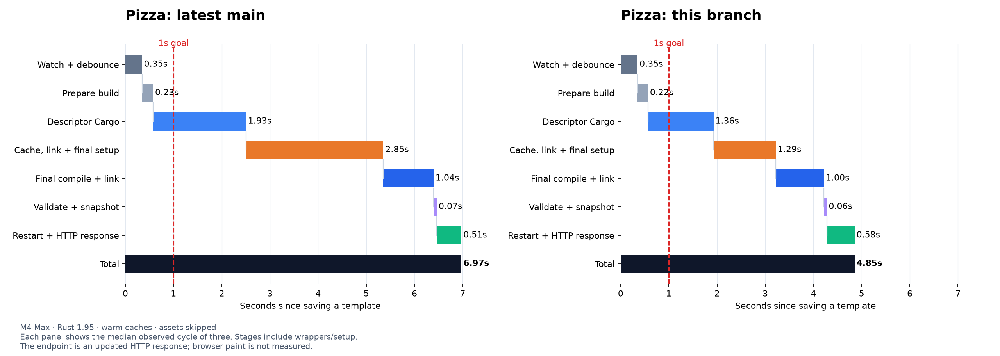
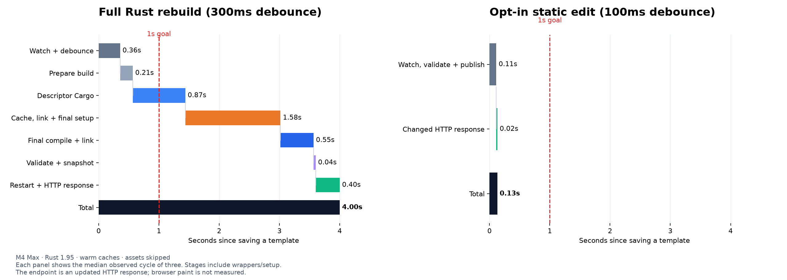

# Development rebuild investigation

Branch `perf/dev-rebuild-pipeline` starts at fetched `origin/main` (`ab6e5cd`).
The worktree is separate from the original checkout. Experiments were run on
2026-10-03 on an Apple M4 Max, macOS 26.5.2, with assets skipped. Rust 1.95 is
the repository's pinned compiler; the compiler matrix separately tests current
stable 1.99 and a pinned nightly. See [implementation details](IMPLEMENTATION.md).

## Measured outcomes

| Warm save to changed HTTP response | Latest main | This branch |
| --- | ---: | ---: |
| Copied `examples/webmcp-pizza`, dev profile, 300ms debounce | 6.97s | 4.85s |
| Standalone 24-route consumer, dev profile, 300ms debounce | 6.91s | 4.00s |
| Explicit hot-static text edit, nodebug profile, 100ms debounce | — | 0.13s |

Each number is a median of three serialized edits with warmed caches and a
release-built CLI. The pizza application was copied to `/tmp` with workspace
inheritance resolved and Proa dependencies linked to this branch. The standalone
consumer has its own workspace, lockfile, profiles, and targets. These are
save-to-response results, including debounce, orchestration, and restart where
applicable; browser navigation, hydration, and paint are not measured.



The pizza median loses approximately 1.56s in cache/link/final setup and 0.58s
in descriptor Cargo; final compilation remains about one second. The orange
stage includes cache validation, semantic linking, and final Cargo startup,
and is not a CPU profile of the semantic linker alone.



The hot row uses a different edit path, profile, and debounce. It bypasses
Cargo for explicitly opted-in compatible edits and has development rendering
overhead; its gain is not attributable to compiler optimization.

## What we tried, in priority order

1. **Cache publication and the actual app waterfall.** Byte-identical durable
   indexes now retain their existing publication. Changed publications preserve
   atomic replacement/durability and the existing cache lease. Symlink and
   corrupted/interrupted-cache checks remain active. This accounts for most of
   the improvement; it remains useful with any future compiler.
2. **Duplicate validation and extraction.** Retain immutable validated object
   bytes and both hash domains through manifest construction and extraction.
   Reuse paired dependency hashes within a cycle. A bounded in-process record
   cache avoids reparsing exact unchanged generations after fresh validation.
3. **Incremental descriptor compilation.** Preserve Cargo's incremental flags
   and codegen partitioning when collecting complete rlibs or native host linker
   object inputs. Partial-edit/removal tests retain unused witnesses across
   multiple codegen units. Unsupported transports keep a conservative complete
   single-object carrier. In the dev-profile fixture, incremental descriptors
   reduce the Cargo stage but archive validation offsets much of that gain;
   there is no demonstrated additional watcher speedup over the cache fix.
4. **Narrow final invalidation.** Implement independent mapping-entry witnesses
   and retain exact root/full-plan validation. The split-crate probe demonstrates
   that a changed global plan still recompiles an unchanged RSJS island in the
   final pass. Complete owner-local reuse requires stable asset/member identities
   and transitive unit projections. See [the architecture experiment](INVALIDATION.md).
5. **Upstream compiler comparison.** Run isolated, serialized configurations
   for the repository compiler, current stable, pinned nightly, next solver,
   parallel frontend, and Cranelift. Results and failures are retained in
   [the compiler comparison](COMPILERS.md).
6. **Scoped static updates.** The remaining full-build latency justifies an
   explicit `html_hot_sync!` / `proa dev --hot-static` prototype. HTTP checks cover
   escaping, static attributes, dynamic fallback, failed builds, and repair.
   [Usage and limits](HOT_STATIC.md) describe its deliberately narrow scope.

## Next decisions

1. Review/land cache publication and validated-data reuse first. They have the
   clearest measured benefit and do not depend on a new compiler backend.
2. Harden/measure complete descriptor carriers on more targets and larger apps.
   Do not infer a broad end-to-end gain from the smaller descriptor Cargo stage.
   Model multiple exact artifacts per extern and use Cargo's public build-script
   observations before adopting the experimental nightly output layouts.
3. Prototype stable owner identities and unit plan projections, then prove both
   unaffected reuse and shared-helper/child invalidation in executable/browser
   output. Avoid removing the global plan witness before those changes.
4. Keep static updates explicit while measuring rendering overhead and fixing
   watcher-session cold builds and source discovery. Broaden supported templates
   only from representative use and correctness evidence.

## Learning and reproduction

Cargo's [incremental profile setting](https://doc.rust-lang.org/cargo/reference/profiles.html#incremental)
controls reuse inside rebuilt crates. Cargo separately skips whole fresh crates.
The compiler guide's [incremental overview](https://rustc-dev-guide.rust-lang.org/queries/incremental-compilation.html)
and [detailed dependency algorithm](https://rustc-dev-guide.rust-lang.org/queries/incremental-compilation-in-detail.html)
explain dependency tracking and result fingerprints. Our collector uses public
rlib/linker outputs rather than inspecting rustc's private incremental directory.

```sh
cargo build -p proa-cli --bin cargo-proa --release
python3 scripts/clone_example_probe.py --help
python3 scripts/compile_time_probe.py --help
python3 scripts/dev_latency_probe.py --help
python3 scripts/compiler_matrix_probe.py --help
```

Raw numerical evidence is in [evidence/](evidence/); SVG waterfalls in
[diagrams/](diagrams/) can be exported. [Historical prototype notes](HISTORICAL.md)
retain the earlier `c3cbaee` investigation and isolated cache experiment; their
estimates and old measurements are not the final branch results above.
