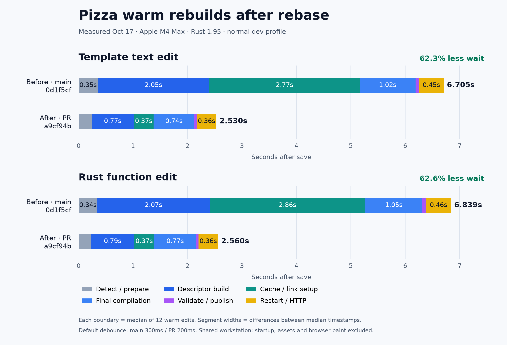

# Development rebuild performance

This branch reduces ordinary warm Pizza rebuilds from about 7s to roughly 2.6s.

## Rebase verification (2026-10-17)

Fresh paired trials compare main `0d1f5cf` with rebased PR code `a9cf94b`:

| Save to changed HTTP response | Main median | PR median | Less wait |
| --- | ---: | ---: | ---: |
| Template text edit | 6.705s | 2.530s | 62.3% |
| Rust helper return-value edit | 6.839s | 2.560s | 62.6% |



[Vector version](diagrams/pizza-rebase-waterfalls-2026-10-17.svg). Each boundary
is the median timestamp of all 12 measured edits for that variant and edit type.
Segment widths are differences between those median boundaries, so each bar
ends at the reported median response time. They are not independently computed
median stage durations. Cache/link setup includes the interval from descriptor
completion through final Cargo preparation; these log boundaries are not CPU
profiles. The evidence below retains every sample's boundaries.

Each variant has 12 measured edits per edit type: two six-edit blocks, each
preceded by one discarded warmup. Blocks run serially in main/PR/PR/main order.
Both release CLIs use Rust 1.95 on the same Apple M4 Max/macOS 26.5.2 workstation.
Standalone Pizza copies use the normal dev profile, assets disabled, no hot-static
opt-in or timing instrumentation, and each CLI's default debounce (main 300ms,
PR 200ms). Startup, assets, browser hydration and paint remain excluded. The
template edit changes a literal title; the function edit changes only the string
returned by a Rust helper used in that title. Each sample waits for the changed
HTTP response, and the source is restored after each block.

Main's template block medians were 6.891s/6.620s, versus PR's 2.515s/2.535s;
function blocks were 6.763s/6.861s versus 2.543s/2.569s. Aggregate medians above
use all 12 edits, rather than averaging block medians. These are observations on
a shared workstation; unrelated compilation and indexing were present, so this
is not an isolated-host experiment or a portable latency guarantee.

[Samples, CLI hashes and historical-claim audit](evidence/rebase-verification-2026-10-17.json)
retain the exact revisions and every measured response time. Reproduce with
the probe below, using `--samples 7`, discarding the first sample of each block,
and repeating the main/PR/PR/main order separately for both edit types. All 773
CLI library tests and formatting passed on `a9cf94b`, as did
[CI](https://github.com/Proa-Labs/proa/actions/runs/39058307442).

The original ~7s to ~2.6s headline remains supported. Recomputing the older raw
medians also confirms the original 57% pipeline reduction, 195.586ms descriptor
debug-info reduction (rounded to 196ms), and 211.910–215.995ms partition savings
(rounded to 212–216ms). Those were separate historical experiments; their savings
must not be added together, and their individual contributions were not
remeasured during this rebase check.

## Original trials (2026-10-03/04)

Measurements were made on 2026-10-03/04 on an Apple M4 Max running macOS 26.5.2
and Rust 1.95, with a release-built CLI and skipped assets.

| Save to changed HTTP response | Median | Samples (seconds) |
| --- | ---: | --- |
| Main: template, 300ms debounce | 6.974s | 7.027, 6.974, 6.844 |
| Branch: template, default 200ms debounce | 2.987s | 2.987, 3.079, 2.932 |
| Branch: Rust function, default 200ms debounce | 2.964s | 2.925, 2.964, 2.965 |
| Oct 4 production CLI: template, 200ms debounce | 2.552s | Six warm edits; boundaries in the compact measurements |
| Oct 4 production CLI: Rust function, 200ms debounce | 2.583s | Six warm edits; helper result changes in HTTP output |

Each case uses three serialized edits with warm caches, ordinary compiled
templates and the normal dev profile; the latest production rows use six edits.
Startup, assets and browser hydration/paint
are excluded. The example was copied to `/tmp` and linked to the corresponding
checkout. The first branch results were measured at code commit `26e6529`;
the latest row includes descriptor policy 7 and the reviewed hot-static fixes.
Follow-up trials appear below. One original sample
exceeded 3s, so these are typical latencies on one machine, not a strict bound.

## Descriptor-size follow-up (2026-10-04)

| Experiment | Before | After | Decision |
| --- | ---: | ---: | --- |
| Omit descriptor debug info | 2.996s | 2.801s | Keep: 196ms saved, full final-app debug retained |
| Share source hashes within validation | 2.717s | 2.723s | Discard: no established end-to-end gain |
| Optimize host build dependencies | 2.742–2.809s controls | 2.709s | Keep optional: first startup rises from 37s to 72s |
| Default descriptor partition count: 256 → 64 | 2.768s | 2.552–2.556s | Keep: 212–216ms saved; explicit profiles retained |

The descriptor trial uses six warm edits per variant with unchanged normal-dev
settings and 200ms debounce. Instrumented file reads fall from 1.76 to 1.20 GiB
per edit; bytes fed to hashes fall from 2.90 to 1.88 GiB. These are warm file
reads, not measured SSD traffic, and exclude compiler-internal I/O and native
carrier copying. The largest descriptor archive falls from 99MB to 27MB. The
final app retains exactly the same 5.65MB of debug sections.

The reuse trial randomized 12 adjacent before/after pairs using one binary and
namespace. Its source-cache implementation was removed. The smaller change
that skips an unused input-domain hash for link-only artifacts remains; the
combined trial reduced manifest-stage medians from 55ms to 38ms, without
establishing an end-to-end win. Hash algorithms and cache identities stay intact.

The build-dependency trial uses six edits per profile, bracketed by six normal-dev
edits before and after. Its modest gain does not justify changing `proa new`
defaults. Descriptor no-debug is a CLI policy and requires no app manifest
change. Policy version 7 intentionally populates a fresh descriptor namespace
on first use, retaining subsequent incremental reuse.

The partitioning trial uses six edits per block without tracing, bracketed by
ordinary-dev controls. A broad 32-unit cap reached 2.571s; repeated broad 64-unit
edits reached 2.603s. The chosen policy retains finer incremental reuse and
preserves every explicit count. Pizza's descriptor library falls from 208 object
members to 65, while the final library retains 201 members and exactly 5.65MB of
debug sections. The separately rebuilt production CLI reaches 2.552s; this is
not an isolated comparison against the diagnostic CLI used for those controls.
A final production-only after/before/after comparison uses six edits per block:
policy 6 reaches 2.768s, while policy 7 reaches 2.552s and 2.556s. The revisions
differ only in descriptor partition policy and its regression tests.

A direct-launch probe attributes roughly 329ms before Rust entry on this Mac to
Gatekeeper/XProtect evaluation: process creation returns in 1–2ms, scan completion
immediately precedes entry, and repeat launches take about 3ms. This is a local
platform cost; no security settings changed. Apple documents scanning changed
executables in its
[XProtect overview](https://support.apple.com/en-ca/guide/security/sec469d47bd8/web).

The historical figure uses representative edits from the original separate trials;
it was not regenerated for the rebase check. Its lower panel
isolates incremental-session preparation and cached-object copying inside rustc.
Compiler profiling adds overhead, and parallel worker durations are not added
as elapsed time. The main remaining
costs are the descriptor and final compiler passes. Detailed profiling stays in
the investigation checkout and is excluded from this PR.


[Compact measurements](evidence/pizza-measurements.json) retain all sample
boundaries, current stage durations, CLI digest and source-record hashes.
Intermediate experiment logs and duplicate figures are omitted from this PR.
The original pipeline logs remain in Git revision `1f2ece6`; follow-up raw
traces stay outside the PR.

## What changed

1. Avoid rewriting identical durable cache indexes; retain atomic publication,
   leases and corruption checks for changed records.
2. Reuse freshly validated carrier bytes and parsed records, deduplicate input
   hashing, use accelerated compatible SHA-256, and publish independent records
   in parallel. The earlier waterfall identified validation and transport work
   as the major setup costs; semantic planning takes less than 1ms.
3. Preserve incremental compilation and multiple codegen units when the CLI can
   collect complete descriptor carriers. Archive validation offsets some compiler
   savings; the descriptor stage alone does not predict end-to-end speedup.
4. Track complete per-unit plan projections and stable runtime/asset identities,
   allowing unrelated final crates to stay fresh. Cargo crate dependencies remain
   the reuse boundary, so Pizza's single component crate benefits less here.
5. Reduce the default quiet window to 200ms and observe graceful server exit
   sooner. `--debounce-ms 300` retains the previous quiet window.

[Implementation](IMPLEMENTATION.md) describes cache/carrier changes;
[invalidation](INVALIDATION.md) explains the dependency contract; the
[author review](REVIEW.md) records compatibility breaks, exact checks and merge
risks. The latest change passes 709 CLI/library/cache/projection tests and strict
CLI-library Clippy; CI must also pass before merging. A coordinated
CLI/macro/runtime release is required.

The optional [static-update prototype](HOT_STATIC.md) uses an explicit macro
and dev flag. Its separate 0.129s trial used a different profile and 100ms
quiet window; it does not contribute to the ordinary Pizza results above.
Scaffolded dev profiles already inherit Cargo's incremental default, so
`proa new` needs no additional manifest flags or automatic prototype opt-in.

## Reproduce

Build the release CLI, then copy an example with
`python3 scripts/clone_example_probe.py webmcp-pizza --output /tmp/proa-pizza-probe`.
Place `EDIT_MARKER_A` in a template's HTTP-visible text in the copied `src/lib.rs`.
Run the probes serially; the watcher probe restores its source afterward.

```sh
cargo build -p proa-cli --bin cargo-proa --release
PROA_BUILD_TIMINGS=1 python3 scripts/dev_latency_probe.py \
  --fixture /tmp/proa-pizza-probe --cli target/release/cargo-proa \
  --source src/lib.rs --url-path / --profile dev
```

Probe output stays in the fixture's `target/probe-logs/`; do not commit the
compiler logs or intermediate plots. `scripts/compile_time_probe.py` provides
isolated build-only trials, and `scripts/hot_static_acceptance.py` checks the
prototype's HTTP behavior.

Cargo's [incremental profile setting](https://doc.rust-lang.org/cargo/reference/profiles.html#incremental)
controls reuse within rebuilt crates; Cargo separately skips whole fresh crates.
The [compiler's incremental overview](https://rustc-dev-guide.rust-lang.org/queries/incremental-compilation.html)
explains the query dependency model. Upstream compiler experiments did not
establish a warm-build win from the next solver on this workload; their detailed
investigation remains outside the implementation diff.
