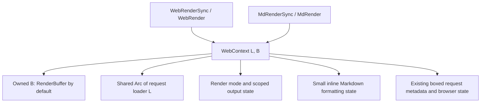

# One WebContext for HTML and Markdown

**Read the five decisions below first, about 90 seconds.** The implementation and downstream migration sequence is in section 4.

Status: implemented and validated on `hariria/refactor-md-context`, September 17, 2026, against `1166812`. The downstream migration is prepared in its owning repository; integration order and verification are recorded below. The API is not publicly released, and the owner explicitly permits breaking changes without deprecation aliases. The expanded API/guard probe passes 14 tests; an expected compile failure verifies the HTTP `Send` boundary in section 3.5. This document records the accepted decisions and migration contract.

**Scope adjustment:** keep eager context parts and remove `MdContext` outright. **Downstream work:** migrate `proa-ui` alongside the refactor, with a separate 8–12 hour budget. No deprecation cycle or version bump is required for this unreleased API.

## 1. Decisions

1. **Use one concrete `WebContext<L, B>` for HTML and Markdown.** All four render traits receive this exact type. No format type parameter, context conversion, or second context implementation.
2. **Put the loader first and buffer second everywhere in the new Markdown API.** Defaults are `L = NoLoader` and `B = RenderBuffer`.
3. **Remove explicit lifetime parameters from Markdown render signatures.** This includes the context argument, async method generics, and the current lifetime bounds on the returned future.
4. **Keep the render traits distinct.** `WebRender` / `WebRenderSync` select HTML rendering; `MdRender` / `MdRenderSync` select Markdown rendering. The traits and their helpers select escaping.
5. **Keep `WebContext` as the canonical name.** It represents a web rendering environment. A future `NativeContext` can represent graphics resources and frame state if native rendering needs them. This refactor does not pre-design that API.

The public contracts become:

```rust
pub struct WebContext<
    L: DataLoader = NoLoader,
    B: WriteBuf = RenderBuffer,
> {
    pub out: B,
    // Shared render state; see section 2.
}

pub trait WebRenderSync<L: DataLoader = NoLoader, B: WriteBuf = RenderBuffer> {
    fn render(self, cx: &mut WebContext<L, B>) -> Result<(), WriteError>;
}

pub trait WebRender<L: DataLoader = NoLoader, B: WriteBuf = RenderBuffer> {
    fn render(
        self,
        cx: &mut WebContext<L, B>,
    ) -> RenderOutcome<impl Future<Output = Result<(), WriteError>>>;
}

pub trait MdRenderSync<L: DataLoader = NoLoader, B: WriteBuf = RenderBuffer> {
    fn render_md(self, cx: &mut WebContext<L, B>) -> Result<(), WriteError>;
}

pub trait MdRender<L: DataLoader = NoLoader, B: WriteBuf = RenderBuffer> {
    fn render_md(
        self,
        cx: &mut WebContext<L, B>,
    ) -> RenderOutcome<impl Future<Output = Result<(), WriteError>>>;
}
```

The web trait excerpt omits its existing hidden identity-witness constants and diagnostic attributes; preserve those during implementation.

`WebContext`, `WebContext<MyLoader>`, and `WebContext<MyLoader, MyWriter>` cover ordinary, custom-loader, and custom-writer authoring. Markdown authors use those same spellings.

**Delete `MdContext` and its public re-exports.** Provide no type alias, deprecation attribute, compatibility shim, or replacement export under that name. Migrate every caller directly to `WebContext<L, B>`. Breaking changes are intentional while the API is unreleased.

The old first type argument was the buffer: `MdRender<Vec<u8>>` becomes `MdRender<NoLoader, Vec<u8>>`, or simply `MdRender` when adopting `RenderBuffer`. Replace `MdContext::new(&mut out)` with `WebContext::with_buffer(&mut out)` to keep a borrowed writer, or use `WebContext::new()` and consume `into_output()` for the default owned buffer. Update both sync and async implementations together.

Ordinary references, borrowed component data, and internal boxed continuations still use Rust lifetimes. Authors do not need to spell lifetimes on either render method. Do not add `B: 'static`, `L: 'static`, `Self: 'static`, or a `Send` future requirement to these traits.

## 2. Shared state and ownership

**Extend the existing `WebContext`; fold `MdContext` into it.** Preserve `pub out: B`, the loader type, and the existing web authoring surface. Organize implementation files by responsibility so one large context file does not become the maintenance boundary.

The merge rationale lives permanently in [the `WebContext` Rustdoc](../../proa_core/src/web/context.rs): shared request state, loader propagation, bridge allocation savings, and separate rendering semantics.

The merge removes a concrete cost: the former `MdContext::render_web` created `WebContext::with_buffer(observed)` for every HTML-in-Markdown bridge. Each call allocated a boxed parts bundle and a new `Arc<NoLoader>`, and its trait bound hard-coded `NoLoader`. Reborrowing the live context removes those two per-bridge allocations and makes its existing loader available to bridged HTML. Cloning an existing loader `Arc` does not allocate another loader handle.



| State | Ownership and policy |
|---|---|
| Output and loader | Own `B` and `Arc<L>`. Preserve `new()`, `with_buffer(B)`, `with_loader(Arc<L>)`, `with_loader_buffer(B, Arc<L>)`, and `into_output()`. Borrowed writers remain possible through `B = &mut Writer`. |
| Common render machinery | One implementation of render modes, output adapters, metering, reservations, flusher configuration, and flushing. Keep scoped output mutation distinct from detached rendering. |
| Markdown state | Inline `MdState`: heading offset, list depth, inline mode, trailing-line state, and pending CR. Rename `MdContextState` to `MdState` and migrate callers directly, without a compatibility alias. Snapshots exclude the loader and output. |
| HTML formatting state | Keep `ContentMode` and `EscapeDialect` cheap to access. Do not introduce Markdown as an HTML escape dialect or switch representation through a global format flag. |
| Metadata and browser state | Keep the existing eager `Option<Box<WebContextParts>>` ownership policy. Ordinary roots have parts, transport-only contexts do not, and scoped output guards temporarily move and return the live box. Existing field-level laziness stays unchanged. |

**Lazy context parts is a follow-up, outside this refactor.** It would change the meaning of `None`, scoped ownership, detached forks, response commitment, and telemetry initialization. The immediate saving would be one roughly 680-byte parts allocation per Markdown root, not one per fragment. That does not justify coupling it to the API migration before measurement.

Accept the existing root setup costs: the parts box, buffer storage, and a loader handle (`Arc::new(NoLoader)` for a no-loader root). Ordinary nested fragments and warmed bridges reuse that state. Preserve the current transport-only restriction, render-start timestamp, and response state without introducing a third parts state or initializing parts on first flush. Measure root construction separately with the existing context-parts benchmark before proposing a lazy-parts change.

Request-scoped mutable state stays owned by the current context. Do not replace it with an `Arc<Mutex<...>>`, clone all metadata for every child, or add dynamic dispatch to ordinary component rendering.

`SendWebContext` remains separate in this refactor: its separation enforces thread-transfer capability. Adding an `Arc<L>` to Markdown does not make a context containing local stream callbacks `Send`. Preserve existing send-render APIs and checks.

## 3. Behavior that must survive the merge

### 1. Loading works throughout the Markdown path

Reuse the existing web loader methods directly: byte loads, JSON loads, typed loads, full requests, and advisory hints. Preserve the explicit `DynLoaderHandle` escape hatch. Do not introduce a Markdown loader trait or a parallel loader implementation.

Both Markdown traits carry `L`. A synchronous component can participate in a tree using that loader type; a component that awaits data implements `MdRender`.

```rust
impl<L: DataLoader> MdRender<L> for Article<'_> {
    fn render_md(
        self,
        cx: &mut WebContext<L>,
    ) -> RenderOutcome<impl Future<Output = Result<(), WriteError>>> {
        RenderOutcome::pending(async move {
            let article = cx
                .load_typed::<ArticleData>(LoadKey::named("article", self.slug))
                .await?;
            md! { r###"
# {article.title.as_str()}

{article.body.as_str()}
"###
            }
            .render_md(cx)
            .resolve()
            .await
        })
    }
}
```

This is proposed authoring syntax; `Article` and `ArticleData` are application types. Existing helper behavior such as `LoadError::NoLoader` and typed-value mismatch errors stays intact.

Thread `L` through `OptimizedMd<L, B, F>`, `AsyncMd<'env, L, B>`, the macro dispatch extension traits, scalar/tuple/option implementations, `to_md_async`, `await_md_component`, root helpers, and `Suspense`. Generated closures accept `&mut WebContext<L, B>`. Internal erased async callbacks need one context-borrow lifetime, as the HTML callbacks already do.

Keep the existing `+ Send + 'env` bound on the erased `AsyncMdRenderFn` **closure**. Its returned `AsyncMdFuture<'cx>` remains a local future without `Send`. Transferring the unopened closure and transferring its active future are different capabilities; the refactor does not change that distinction.

Use one request-scoped loader instance across nested HTML and Markdown. If the caller supplies `DataResolver::request_scope(...)` or a `PreparedLoader`, pass that instance through unchanged. The context does not invent a second cache or promise deduplication from an arbitrary `DataLoader` alone.

### 2. Format-specific operations have explicit names

The common context owns state; the chosen trait determines how a value renders. A value implementing both traits can produce two representations using the same context type.

| Operation | Unified spelling / rule |
|---|---|
| Compose synchronous children | Use `child.render_md(cx)` or `child.render(cx)`. Remove the old Markdown `cx.render(child)` convenience. Add no `cx.render_md(child)` or `cx.render_html(child)` synonym; the receiver convention matches existing HTML authoring. |
| Literal Markdown text | `cx.write_md_text(...)`; retain Markdown escaping and newline normalization. HTML text continues through HTML renderers and their existing escaping helpers. |
| Prepared Markdown syntax | `write_md_prepared`, `write_md_prepared_static`, and `write_md_prepared_shared`; keep borrowed, static, and shared buffer fast paths distinct. |
| Markdown structure | Prefix format-specific helpers: `md_heading`, `md_block_boundary`, `md_line_boundary`, and corresponding list/inline helpers. |
| Markdown state snapshots | `md_state`, `set_md_state`, and scoped Markdown-state helpers. Keep the snapshot small and independent of flushed bytes. |

This source-breaking migration is a suitable point to make these names explicit. New macros and generators should emit the new names. Ambiguous old names need not become permanent methods on the shared type.

A shared context permits direct low-level HTML or buffer calls from Markdown code. That is a real loss of context-type separation. Keep macro child trait checks, use the tracked interop helper below, and document that direct `out` writes bypass Markdown bookkeeping. Do not compensate by guessing the format at runtime.

### 3. Interop preserves the same buffer and request environment

**Markdown rendered through a web trait:** `OptimizedMd` and `AsyncMd` already implement web traits. Change those implementations to invoke the Markdown continuation on the existing `WebContext<L, B>`. No buffer move, replacement buffer, second loader, or second request context is needed.

Preserve existing fragment isolation with a small Markdown-state scope: a Markdown fragment entering through its web implementation starts with a fresh complete `MdState`, including its logical suffix. It restores the outer snapshot on completion, error, panic, or cancellation. Direct `MdRender` composition keeps the current Markdown state. Use a guard borrowing the live context and exposing a scoped mutable reference; do not move the owned buffer out of an initialized context slot.

**Use a safe borrowed guard for the async fragment bridge.** An internal `MdFragmentScope<'cx, L, B>` holds `cx: &'cx mut WebContext<L, B>` and the saved `MdState`. Its constructor snapshots and resets Markdown state; `context(&mut self)` reborrows the context; `Drop` restores the snapshot. The async body has this shape:

```rust
let mut scope = MdFragmentScope::new(cx);
(self.render_fn)(scope.context()).await
```

The awaited child borrows the guard, so Rust drops the child future before the guard during cancellation or unwind. No raw pointer, unsafe block, or extra heap allocation is needed for this guard. The probe verifies this exact ownership shape using the existing `WebContext` content-mode field as a stand-in for the future `MdState`: success, error, cancellation, panic after an await, and nested scopes all restore state. It also uses a `Send` erased closure returning a local future. The existing raw-pointer Markdown `Suspense` cleanup is a separate mechanism; migrating its context type does not require rewriting it in this change.

**HTML rendered inside Markdown:** retain the explicit tracked bridge, named `render_html_in_md` in the new API. Reuse `ObservedMdWriteBuf` and the common scoped-output machinery. The observer updates logical Markdown suffix state for every successful write, including static, shared, and in-place writes. It must work after a streaming flush, with noncontiguous buffers, and when a renderer errors or panics.

The observed child uses the same `L` and the live request state. Enter it with `ContentMode::Html` and `EscapeDialect::Html`, matching the old bridge's fresh web context; restore both afterward. Keep its observed suffix separate from temporary Markdown-fragment scopes and merge it during guard cleanup, so nesting `Markdown → HTML → Markdown` cannot discard the actual output suffix. Use disjoint field borrows and local observer state; do not reconstruct the suffix by reading a contiguous buffer tail or cast between different `WebContext<L, B>` instantiations.

The restoration rules are deliberately different for these scopes:

| Scope | Formatting and suffix on exit |
|---|---|
| Direct Markdown composition | Inherit the current Markdown state and keep updates. |
| Markdown fragment through a web trait | Restore the saved complete Markdown state; retain the bytes written. An enclosing HTML-in-Markdown observer still sees those bytes. |
| Tracked HTML inside Markdown | Restore the caller's HTML mode/dialect and Markdown heading/list/inline state; retain the suffix computed from actual successful writes. |
| Output, meter, or reservation adapter | Return the child's updated state to the parent, including on error/unwind/cancellation. This is an ownership handoff, not a rollback to the entry snapshot. |

All these scopes preserve the live request/response state and artifact transaction identity. Formatting isolation does not undo metadata changes. Existing explicit error/transaction boundaries remain responsible for rollback when they discard a rendered subtree.

The tracked bridge changes the concrete buffer to `ObservedMdWriteBuf<'_, B>`. Its child must implement `WebRenderSync<L, ObservedMdWriteBuf<'_, B>>`; a component implemented only for the default `RenderBuffer` does not automatically satisfy that bound. Preserve this existing custom-writer limitation and test it explicitly. Keep the observer's current `WriteBuf` capabilities; adding checkpoint-writer support is separate work. Do not hide the mismatch with an intermediate buffer or per-child type erasure.

The existing tracked HTML bridge is synchronous; preserve that scope. Generalizing it to arbitrary async HTML can be a later API addition. Async Markdown-to-web composition remains supported now.

### 4. Scoped output and streaming have one implementation

Move Markdown state through the existing scoped-output guard alongside the other context fields. Reuse `with_output`, `with_metered_output`, `with_metered_output_async`, and `with_reserved_output`. An adapter can change `B`; it must preserve `L`, metadata, render mode, stream handles, and format state. Return ownership and updated state on success, error, panic, and async cancellation, according to the table above.

Retain reservation semantics: debit once; require exact consumption on success; preserve the original rendering error; restore state during unwind. Preserve static/shared/in-place writer delegation and avoid allocating in these warmed scoped operations.

Use the same `flush_stream_chunk` implementation for both formats. With a flusher installed, a nonempty attempted flush records response commitment and advances the flush generation before handing bytes to the flusher; even a failed attempt discards the attempted buffer contents. An empty flush creates no new commitment and never reopens already committed headers. An HTTP adapter may commit headers before any body flush, so preserve that separate latch as well. Markdown suffix state survives physical buffer clearing. Response parts already exist on ordinary roots; flushing gains no lazy initialization branch.

Markdown `Suspense` remains in document order. It uses `MdRender<L, RenderBuffer>` on the same context and retains the existing cleanup rules for unflushed bytes and Markdown state. It still ignores fallback, timeout, and priority; sharing the context must not make it select a registered HTML error fallback. Errors propagate through the Markdown path. HTML out-of-order boundaries continue to use explicit forks.

Preserve the field-aware `WebContextParts` fork contract, including committed headers, artifact transactions, and shared-state identity. A single context type does not make a scoped reborrow interchangeable with a detached child. Cross-format rendering participates in the active artifact/seed transaction; test error and cancellation through existing boundaries, including a nested flush that has already made bytes unrecallable. Keep browser finalization at HTML response boundaries; sharing the context must not add an HTML shell, head tags, or hydration bootstrap to Markdown responses.

### 5. Framework entry points actually expose loader-backed Markdown

**Keep the trait/context default and output-format helpers distinct.** `WebContext<L>` and `MdRender<L>` still select `RenderBuffer`. The existing `render_md_to_vec_async` and `render_md_to_string_async` helpers continue rendering directly into an owned `Vec<u8>`, using `R: MdRender<NoLoader, Vec<u8>>`. String conversion consumes that vector with UTF-8 validation. Custom-loader/custom-buffer callers use `render_md_in_context_async<L, B, R>` with lifetime-free arguments; a default-buffer-only component can use it with `WebContext<L>` and consume the resulting `RenderBuffer`.

This keeps the contiguous helpers' existing buffer capability requirement explicit. A component implemented only for `RenderBuffer` does not automatically implement `MdRender<NoLoader, Vec<u8>>`. Do not render to pages and silently flatten inside the `Vec` helper.

For Axum, use the default `RenderBuffer` and consume its owned pages as HTTP body chunks. The exact synchronous bound changes from `MdRenderSync<Vec<u8>>` to `MdRenderSync<NoLoader, RenderBuffer>` in both `negotiate` and `explicit_markdown`; the async loader path uses `MdRender<L, RenderBuffer>`. This allows ordinary components to omit `B`.

`RenderBuffer::into_vec()` already transfers a single-page allocation without copying; only multi-page output is flattened. Preserve that fast path for one-page responses. Add a consuming owned-page iterator for larger responses and a buffered-pages body representation in framework core. Axum can build a body directly from those owned chunks, without the deferred rendering machinery or a local executor. All rendering and error handling finish before response construction, and the known total byte length remains available for `Content-Length`. This is buffered rendering with chunked body storage, not a new render delivery mode. The iterator must transfer page ownership, skip empty pages, drop unused spare pages, and preserve written lengths. Measure transport bookkeeping allocations separately; zero flattening copies does not mean zero transport allocations.

Extend the in-order Markdown driver to store/pass `Arc<L>`. Use loader-first ordering when declaring the new driver type, for example `InOrderMarkdownDriver<L, R>`, while retaining a convenient no-loader constructor. Add loader-taking variants of the free driver helpers; existing no-loader forms delegate to them.

The current Axum representation helpers only accept synchronous Markdown and retain its `Vec<u8>` body, with no rendered response metadata. Updating the trait alone would leave loader-backed async Markdown inaccessible there.

**Use a deferred Markdown response for the async HTTP path.** An `async fn` that owns `WebContext` across `.await` produces a local future that does not satisfy Axum's `Send` handler requirement. The compiler probe confirms this. Adding `M: Send` cannot fix the active context, and `MdRender` itself must remain usable with local futures.

1. **Construct a response before starting the renderer.** Add `negotiate_async_with_loader` / `explicit_markdown_async_with_loader` as ordinary `fn` constructors for a buffered Markdown response plan. Here `async` describes the renderer, following `RouteResponse::ssr_async_with_loader`; the handler returns the plan without awaiting its local render future. Accept `Arc<L>`, `L: DataLoader + 'static`, and `M: MdRender<L> + Send + 'static` at this HTTP boundary only. Keep synchronous `negotiate` / `explicit_markdown` conveniences and their immediate `Result` error contract, now using the default `RenderBuffer`.
2. **Drive the selected plan inside the adapter.** Store an unopened render request, not a constructed context or active future. Create those where rendering executes and reuse the existing buffered HTML finalization policy. Keep the portable local-future finalizer in framework core and Tokio execution in Axum. If `RepresentationResponse<L>` needs erasure, use a private boxed callback or a dyn adapter like `DynWebRender`; `MdRender`'s opaque future prevents `Box<dyn MdRender<L>>`. Boxing belongs at the response boundary only. Deferred render errors use the adapter's existing HTTP error mapping; they cannot be returned from the earlier constructor.
3. **Pass the full request environment.** Initialize Markdown with the same `FrameworkRequestContext` fields as HTML: request method/headers, location, route parameters, render mode, and CSP nonce. Share the extraction/setup code. Preserve standalone synchronous helper calls with a default request snapshot when no route context is installed. Accept an already prepared request-scoped loader and preserve its `Arc` identity. Do not extract it from private `RouteResponse` internals or construct a fresh resolver in a fragment.
4. **Carry metadata through finalization.** Both synchronous and asynchronous Markdown paths must return status, headers, and body through a structured core response, rather than discarding everything except bytes. Apply `text/markdown` content type and preserve status and repeated `Set-Cookie` values. For negotiated responses, merge `Accept` into `Vary` without replacing unrelated values or `*`; explicit `.md` responses need no added `Accept` variance. Preserve existing link values when adding an alternate link. Omit HTML document/head/bootstrap finalization.
5. **Prove the actual handler contract.** Keep the existing Accept preference and explicit `.md` behavior. Select the representation before executing a renderer; the unselected renderer and its loads must not run. An Axum route test must await real loader work inside rendering, including a component that creates `Rc` state after rendering starts. Test buffered error mapping on Tokio's multithread runtime, matching the existing buffered async adapter path. Core tests separately cover local futures and borrowed loaders without HTTP bounds.

In-order Markdown streaming remains available through the loader-aware driver. This refactor does not add a generalized route-plan framework, new Markdown HTTP delivery modes, or a new executor for single-thread HTTP finalization. The portable core remains independent of the Axum/Tokio execution policy.

## 4. Implementation sequence

**Planning estimate: 22–36 hours for this workspace, plus 8–12 hours for `proa-ui`: 30–48 hours total, roughly 4–6 working days for someone familiar with both repositories.** The core range includes the preflight below, HTTP adapter work, page ownership transfer, and regression checks. Lazy parts is excluded. These are engineering estimates, not measured implementation times; unrelated failures and cross-repository integration can add elapsed time.

### Downstream migration

The downstream `proa-ui` workspace currently points its Proa dependencies at Git `branch = "main"`, including `proa_core`. A fresh resolution or dependency update after this merge will adopt the breaking API. An existing committed Cargo.lock does not advance merely because main changes, but it is not a replacement for an explicit compatibility policy.

**Migrate `proa-ui` alongside the refactor.** Prepare its changes against the refactor revision in its owning repository and validate component, catalog, application, and generated-code checks. Update its Proa dependency resolution and lockfile together. If the two repositories need to land at different times, a temporary pin to a verified compatible Proa revision can bridge the gap; pinning is an integration option, not a mandatory public-release gate. Update all dependencies from the Proa repository consistently.

The reviewer supplied this planning inventory; counts depend on search scope and are not AST-derived effort estimates:

| Migration surface | Review inventory |
|---|---:|
| `MdContext` mentions in this workspace | 396 |
| Markdown trait implementations in this workspace | 216 |
| Borrowed `MdContext::new` / `with_buffer` calls here | 67 |
| `MdContext` mentions in `proa-ui` | 601 across 83 files |
| Markdown trait implementations in `proa-ui` | 228 |

A local recheck confirms the 67 constructor calls and the 601 downstream Rust references across 83 files. Rust-only context references in this workspace currently total 388 across 75 files. Recount before migration; include multiline implementations, generated strings, fixtures, and documentation in the actual edit inventory.

**Treat this as an unreleased API cleanup.** `proa_core`'s manifest version and `publish = ["crates-io"]` setting do not establish that a public release occurred. The owner confirms it has not, so this refactor does not require 0.4.0, a coordinated version bump, or a deprecation period. Record the API changes in the existing `CHANGELOG.md` Unreleased section and keep the accepted internal migration guide at `docs/migrations/web-context.md`. The downstream migration remains real implementation work even though public compatibility is not a constraint.

### Preflight before step 1: 2–3 hours, included above

Add a small `markdown_render` benchmark before changing the trait signatures. Save a baseline on the old API for root construction, reused buffers, sync/async rendering, and repeated HTML-in-Markdown bridges, with small and multi-page outputs using both `Vec<u8>` and `RenderBuffer`. Record allocations separately from elapsed time. The existing `suspense_boundary_scaling` bench already has a `markdown_suspense_boundary_scaling` group; reuse it, but add the missing ordinary root/bridge coverage. Keep `context_parts_page` as the baseline for any later lazy-parts proposal.

Audit the lint gates before migrating authors. The actual coupling is:

| Lint area | Required treatment |
|---|---|
| Markdown implementation dispatch | `lint_markdown_render_impl` selects `MdRender` / `MdRenderSync` and `render_md`, independently of the context type. Preserve that path and its context identifier matching. |
| Standalone render functions | `function_has_web_context_param` / `block_constructs_web_context` feed `function_is_standalone_render_entry`, which selects free `render_*` functions. They do not reclassify every trait method. A shared context proves render capability, not HTML format. |
| Gated rules and helper traversal | These entries run `check_render_block_perf` (`PerfVisitor`) and `check_direct_helper_perf`. Keep format-neutral allocation/copy checks; make guidance for `perf/manual-escape`, `perf/manual-escape-helper`, and raw-HTML writes depend on HTML evidence. Context type alone must not recommend HTML escaping for Markdown. |
| Renamed Markdown helper detection | Update `md/manual-write` matching for `write_md_prepared*` and the diagnostic at the current line 905 to name `WebContext` and its new Markdown helpers. Updating only the message would leave the rule stale. |
| Regression fixtures | Cover Markdown impls, standalone `render_md_*` helpers, HTML helpers, generic shared helpers, and Markdown code literals containing HTML-looking text. Preserve the independent `perf/render-copy` composition pass, which already scans all functions. |

Implement the core and macro changes on one branch; they must move together before the workspace can compile against the new signatures.

1. **Change the Markdown contract and loader propagation: 3–5 hours.** Update traits, adapters, scalar implementations, fragments, and macro signatures to `WebContext<L, B>`. Remove `MdContext` and use loader-first defaults. Gate: sync/async Markdown components compile without render-method lifetimes and use a custom loader.
2. **Merge formatting state and scoped behavior: 4–6 hours.** Move Markdown state/helpers into the shared context, fold output adapters together, and implement the safe fragment guard and tracked HTML bridge. Keep existing eager parts. Gate: state, escaping, error, panic, cancellation, and warmed allocation checks pass.
3. **Wire streaming and response helpers: 6–10 hours.** Thread `L` through `Suspense`, the driver, root helpers, and deferred responses. Add owned-page HTTP handoff. Gate: real Axum handlers return default-buffer Markdown, await loader data, preserve request/response metadata, and avoid multi-page flattening.
4. **Migrate workspace authors and generated code: 4–6 hours.** Update applications, examples, CLI templates/lints, editor fixtures, benchmarks, documentation, and trybuild expectations. Include both `proa_third_party` renderers: analytics stays silent in Markdown and YouTube stays a semantic link. Gate: scaffolds compile and all workspace targets check. Complete the separately budgeted `proa-ui` migration alongside this work.
5. **Verify and integrate: 3–6 hours.** Compare against the saved Markdown/HTML benchmarks, complete the acceptance matrix, and update the Unreleased changelog and migration guide. Gate: allocation changes are explained, buffered output is not copied unnecessarily, and both repositories have a tested compatible revision pair.

Source map for implementation:

| Area | Start here |
|---|---|
| Context and traits | [web context](../../proa_core/src/web/context.rs), [Markdown context](../../proa_core/src/md/context.rs), [Markdown traits](../../proa_core/src/render/md_render.rs) |
| Fragments and component migration | [Markdown fragments](../../proa_core/src/md/mod.rs), [Markdown macro emitter](../../proa_macros/src/md.rs), [scalar rendering](../../proa_core/src/shared/numeric.rs), [GoogleAnalytics](../../proa_third_party/src/google.rs), [YouTubeEmbed](../../proa_third_party/src/youtube.rs) |
| Loading and streaming | [existing loading methods](../../proa_core/src/web/context.rs), [Markdown driver](../../proa_stream/src/driver/in_order_markdown.rs), [Suspense](../../proa_stream/src/suspense.rs) |
| Responses and authoring tools | [representation helpers](../../proa_framework/proa_framework_axum/src/route/representation.rs), [Axum execution boundary](../../proa_framework/proa_framework_axum/src/route/response.rs), [portable response core](../../proa_framework/proa_framework_core/src/response.rs), [CLI templates](../../proa_cli/src/site_scaffold/templates/ui.rs), [lint gates](../../proa_cli/src/lint/mod.rs) |
| Verification and integration | [loader tests](../../proa_core/tests/load_context_test.rs), [Markdown macro tests](../../proa_macros/tests/md_tests.rs), [Markdown streaming semantics](../../proa_stream/tests/in_order_markdown_suspense_semantics.rs), [allocation checks](../../proa_core/tests/output_meter_alloc.rs), [changelog](../../CHANGELOG.md) |

## 5. Acceptance and evidence

| Check group | Required evidence before implementation is complete |
|---|---|
| Public API and generation | All four traits accept exactly `WebContext<L, B>`; defaults and order are correct; borrowed data, loaders, and writers work; no unnecessary `'static` or `Send` future bound in core; the erased callback remains `Send`; macro dispatch stays unambiguous; workspace and downstream authors migrate with no misleading alias. |
| Data loading | Markdown typed/byte/JSON loads preserve keys and hints; no-loader/type/decode errors propagate; adapters and bridges keep the same loader instance; a supplied request resolver deduplicates within one request and is fresh across requests. |
| Rendering and interop | Escaping remains format-specific; HTML-in-Markdown enters HTML mode/dialect and restores the caller's values; heading/list/inline nesting and split CRLF are correct; the safe async guard restores on every exit; observed writes preserve suffix state after errors/unwind; custom-writer bounds and zero-copy/numeric hooks are covered; Markdown lint guidance stays format-correct. |
| State, streaming, and responses | Metering charges once; guards restore ownership on error/panic/cancellation; failed flushes cannot replay bytes; empty flushes preserve the existing header-commit state; Markdown keeps document order and cannot select HTML fallbacks; HTML detached transaction rules still pass. Real Axum route tests prove local-future execution, request initialization, selected-renderer loading, status/cookies, merged Vary/link headers, and error mapping. |
| Performance and resources | Saved root/bridge benchmarks quantify the extra Markdown root parts allocation and removal of both per-bridge allocations. Warmed metering/reservation scopes allocate no heap state. Vec/String helpers render directly into Vec; single-page handoff reuses its allocation; multi-page HTTP output transfers page ownership without flattening, preserves byte order/length, and releases pages after body completion or cancellation. Measure future sizes and retain detached-boundary, transport-only, and telemetry behavior. |

Workspace completion commands, run from the Proa root after implementation:

```bash
cargo proa check --changed --base 1166812 --allow-warnings
cargo fmt --all --check
cargo check --workspace --all-targets --locked
cargo test --workspace --lib --no-fail-fast --locked \
  --exclude proa_demo --exclude proa_marketing \
  --exclude proa_showcase_web --exclude proa-lean-server \
  --exclude proa_webmcp_pizza --exclude proa_origin_routing_atlas
cargo test --workspace --tests --no-fail-fast --locked \
  --exclude proa_demo --exclude proa_marketing \
  --exclude proa_showcase_web --exclude proa-lean-server --exclude proa_showcase \
  --exclude proa_webmcp_pizza --exclude proa_origin_routing_atlas
python3 scripts/proa_perf_lint.py --changed --base 1166812
```

The exclusions extend [CLAUDE.md](../../CLAUDE.md) to the newer pizza and ORIGIN examples: plain Cargo test binaries that link dependency island rlibs hit the RSJS link guard. Exercise affected excluded applications through their linked `cargo proa test --root <project> -p <package> --bin <binary>` or `--test <target>` pipeline, with their configured root/target and example-local checks; exclusion is not a test waiver. Run downstream checks from `proa-ui`'s own repository and instructions, not by adding it as a Proa workspace prerequisite.

The explicit base keeps committed refactor changes in CLI/perf checks; replace it with the actual starting revision if implementation begins later. `cargo proa check` includes template formatting and lints. Compare the new preflight Markdown benchmark plus existing `context_parts_page`, `suspense_boundary_scaling`, and allocation checks. Extend behavioral tests where the contract needs evidence, not tests that merely pin hard-coded prose.

**Verified during design:** the isolated API probe used during review compiled against the existing `proa_core` build and passed **14 tests**: nine API/ownership tests plus five safe-guard tests added for this review. It demonstrates all four trait signatures sharing `WebContext`, distinct escaping, typed async loading, loader/buffer/context identity, borrowed values/writers/loaders, no-loader errors, and a transferable unopened render request. The guard tests use existing content-mode state as a stand-in for Markdown state and verify restoration through a local awaited future on success, error, cancellation, unwind, and nesting. The prior alias test now checks loader-before-buffer ordering directly, matching the decision to remove the alias.

Compiling the same probe with `--cfg probe_require_send` **fails as expected**: the directly awaited root retains `WebContext`'s local `Rc` state across `.await`. The compiler diagnostics recorded during review support the deferred HTTP boundary above. This is a type-level proof, not an Axum integration test.

The probe did not implement actual Markdown nesting, tracked HTML interop, macros, owned-page HTTP transport, or framework integration. It was design evidence only; lazy context parts remains deferred. The implementation results below come from the actual rendering APIs and downstream migration.

### Implementation evidence

The implementation removes `MdContext`, its re-exports, and its ambiguous write
aliases. Both Markdown render traits use loader-first generics with the default
owned buffer. The actual fragment guard uses safe borrows; HTML interop uses the
existing output scope and an independent suffix observer. No lazy parts state or
new production unsafe block was introduced.

The downstream `proa-ui` component library, catalog, and independent `vm/`
workspace are migrated on the same branch name in their owning repository. Local
Cargo overrides verified them against this checkout; those machine-specific
paths are not committed. Integration must merge the core refactor first (or pin
the downstream to its published Git revision), then refresh both downstream
lockfiles to that revision. Until that happens, unpatched downstream resolution
against old `main` cannot compile the new API. The VM migration also updates the
framework package alias and streaming tests for the already-merged main API.
Six component expectations were updated to the current core escaping rules;
the core escaper itself is unchanged by this refactor.

Validation evidence:

- `cargo check --workspace --all-targets --locked` and Rust formatting pass.
- The workspace unit/integration run completed with **3,209 passes** and one
  generated-template formatting mismatch. After synchronizing the bundled
  template and example, the complete **662-test CLI library rerun passes**.
  All other workspace targets passed in the full run, including the linked
  helper, transport, loader, macro, and response regressions.
- Downstream component tests: **1,118 passed**. VM unit, integration, and
  compile-fail suites: **561 passed**. Downstream workspace checks and VM Clippy
  complete; Clippy reports warnings without failing the check.
- Core/framework/stream doctests: **18 passed**, eight existing examples ignored.
- Shared-context regressions: **14 passed**; allocation regressions: **3 passed**.
  The loader-aware Markdown driver test also proves that a catchable child
  failure cannot select a registered HTML error fallback.
- CLI library/scaffold/lint tests: **662 passed**. The linked ORIGIN application
  suite passes **five tests**, including its live Markdown route; showcase
  library tests pass **22 tests**.
- Focused allocation lint passes in both repositories. The source CLI check
  passes with `--allow-warnings`; strict mode reports 12 existing warnings in
  generator fixtures and finalizers. Running the current lint
  against the same files from `1166812` reproduces those findings.
- The HTML context-parts benchmark's allocation assertions still pass:
  **zero allocations** for a warmed full-page render, with detached-boundary
  rendering exercised separately. HTML and Markdown Suspense scaling cases
  also pass their benchmark smoke runs.

`markdown_render` was added and run before changing the API. On this machine,
the saved `before-context-merge` baseline and the migrated implementation report:

| Measured operation | Before: allocations / bytes | After: allocations / bytes |
|---|---:|---:|
| Small root, `Vec<u8>` | 6 / 504 | 8 / 1,200 |
| Small root, `RenderBuffer` | 1 / 4,096 | 3 / 4,792 |
| Multi-page root, `RenderBuffer` | 4 / 12,352 | 6 / 13,048 |
| Reused small render, either writer | 0 / 0 | 0 / 0 |
| 32 warmed HTML bridges, either writer | 64 / 22,272 | 0 / 0 |

The extra root cost is **two allocations totaling 696 bytes**: the existing
parts box and no-loader `Arc`. It is paid once per root. The first multi-page
buffer reuse still allocates one 64-byte spare-page vector in both versions;
that is existing buffer recycling behavior. The new allocation regression test
also checks repeated HTML bridges and Markdown fragments together.

For context, the 32-bridge `RenderBuffer` timing moved from about 2.44 µs to
0.565 µs in the local Criterion runs. Other compilation was active during some
measurements, so the deterministic allocation counts are the primary result;
these timings are not a portable performance guarantee. Multi-page response
and owned-page iterator tests check byte order, length, and allocation identity.


A local Rust 1.95 / aarch64 layout probe compared the baseline and migrated
`AsyncMd` web bridge around a suspended continuation. `WebContext` remains
**152 bytes** in both builds; the bridge's `RenderOutcome` shrinks from **88 to
72 bytes**. These are measurements, not stable Rust layout guarantees.
