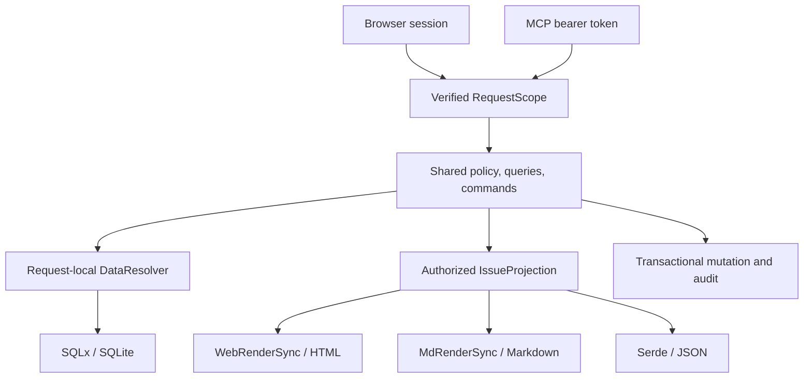
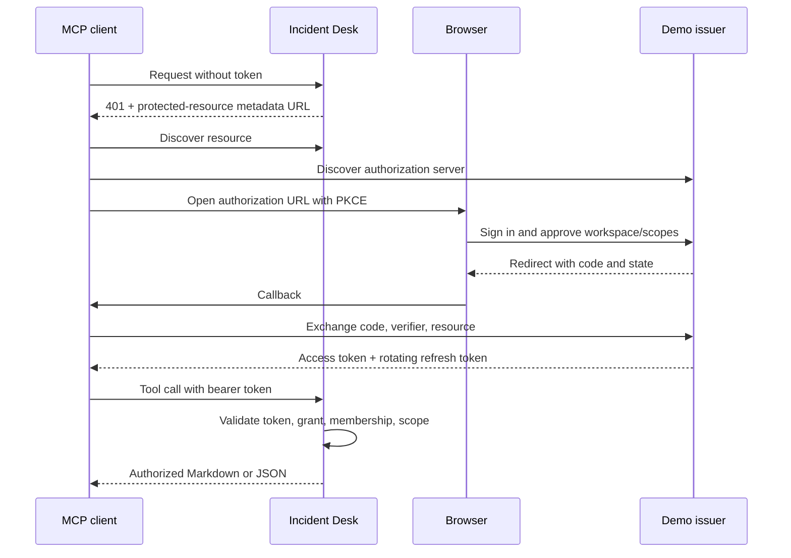

# Incident Desk

**Start with [Build order](#build-order).** The first task is to generate the app and prove desktop OAuth compatibility.

Status: implemented; desktop verification pending · Updated: 2026-09-10 · Package: `mcp-incident-desk` · Location: `examples/mcp-incident-desk/`

Verified: native Codex OAuth and MCP reads/write, plus the resulting browser state. Actual model-driven conversations in both desktop apps remain pending. See [verification evidence](VERIFICATION.md).

Build an incident-triage app where a person investigates an issue in HTML and an agent investigates the same issue through MCP. Both use the same data, permissions, reusable components, and resolution command.

## Decisions at a glance

| Decision | Requirement |
|---|---|
| Foundation | Generate with `proa new site`. Use SQLite, SQLx, and the CLI's `migrations/` workflow. |
| Human interface | Server-rendered HTML with real OAuth/OIDC login and persistent browser sessions. |
| Agent interface | Authenticated MCP with composed Markdown briefs and typed JSON results. |
| Code reuse | Share queries, authorization, loaders, projections, components, and mutations. Give HTML and Markdown their own presentation implementations. |
| Desktop support | Complete the full OAuth and tool-use journey in **both Claude Desktop and Codex Desktop on macOS**. |

**Done means:** an agent signs in, investigates `AST-1042`, resolves it with permission, and the change appears in HTML. Unauthorized access fails. Data and unexpired credentials survive an app restart. Both desktop apps must pass.

Read by task: [Demo](#demo) · [Setup](#application-setup) · [Shared code](#shared-code) · [Authentication](#authentication) · [Acceptance](#acceptance)

## Build order

1. **Generate and prove compatibility.** Scaffold the SQLite app; adapt workspace dependencies. Verify the CLI lifecycle, SDK integration, HTTPS, and OAuth registration in both desktop apps before building the full UI.
2. **Build the persistent domain.** Generate migrations, seed fictional records, and implement SQLx repositories and policy. Prove workspace isolation and transactional resolution/audit behavior.
3. **Complete authentication.** Add provider login, browser sessions, MCP grants, refresh rotation, and revocation. Prove fresh-client OAuth and persistence across restarts.
4. **Connect the shared views.** Implement report components, HTML forms, Markdown brief, JSON projection, and six MCP tools. Verify values and permissions agree across representations.
5. **Finish the demonstration.** Add the comparison lab and setup guide. Run every acceptance check, including both desktop conversations, against the final app.

## Demo

### Seeded world

Use an original interface named **Incident Desk**, inspired by incident-tracking software. Use fictional data; do not copy Sentry branding or imply a Sentry integration.

| Account | Workspace | Role |
|---|---|---|
| Alice | Aster Commerce | Maintainer: read and resolve |
| Ben | Aster Commerce | Viewer: read only |
| Casey | Harbor Analytics | Maintainer, limited to Harbor |

Seed 12 issues with stable IDs, projects, owners, releases, event samples, runbooks, and activity. Include a recognizable private marker in Harbor for isolation tests. Fixture timestamps stay stable; authentication and new activity use the current clock, injectable in tests.

**Featured issue:** `AST-1042`, a checkout timeout after release `checkout-2026.09.08.3`. Show increased errors, deployment timing, a stack sample, and a connection-pool runbook. Present correlation as evidence to investigate, not a proven root cause.

### Five-minute walkthrough

1. Sign in as Alice through the demo provider and open `AST-1042` in the browser.
2. Connect a desktop MCP client without existing credentials. Complete browser login and explicit workspace/scope consent.
3. Ask “Investigate AST-1042. Show the evidence and next checks.” Inspect its Markdown brief and request exact fields through the JSON tool.
4. Grant write access and ask “Resolve AST-1042 with the note: Increased the connection pool limit and verified recovery.” Refresh HTML to see the status and attributed activity.
5. Revoke the connection. Confirm the next tool call fails before the access token expires.

Run viewer and cross-workspace denial checks in [Acceptance](#acceptance).

### Browser surfaces

| Surface | Content |
|---|---|
| Issues | Compact table: status, severity, affected users, release, last seen; workspace/status filters. |
| Issue detail | Shared overview, impact, release, runbook, and activity; owner/status sidebar and resolution form. |
| Connections | Client, workspace, permissions, expiry, and revoke action. No credential values. |
| Connect an agent | Endpoint and separately tested setup instructions for each desktop app. |
| Developer lab (`/lab`) | Authenticated HTML/Markdown/JSON comparison for one authorized revision, source links, bytes, token counts, and loader-read counts. |

Use Proa SSR, forms, and progressive navigation. Keep implementation measurements in the lab. Initial scope excludes telemetry ingestion, external APIs/notifications, AI-generated summaries, enterprise identity features, and production deployment. The deterministic reference client needs no LLM API.

## Application setup

### Generate the site

Use the current checkout's CLI with the `app` preset, SQLite, and blank starter content:

```text
proa new site <fresh-staging-parent>/mcp-incident-desk --template app --database sqlite --starter blank --title "Incident Desk" --yes --no-git
```

`<fresh-staging-parent>` is a placeholder. The generator rejects existing destinations. Generate with the same basename in a fresh staging directory, then incorporate its files into this example while preserving `DESIGN.md` and checking conflicts.

Preserve the generated application contract:

- **Configuration:** `proa.config.json`, `proa.lock.json`, environment loading, and explicit app-binary selection alongside the reference-client binary.
- **Database:** `src/db.rs`, `AppState.db`, `migrations/`, `data/`, and migration tracking in `build.rs`.
- **Web structure:** registered pages/endpoints, source components, layouts, public assets, styling, and health/readiness routes.
- **Lifecycle:** `proa dev`, `proa build`, `proa start`, and `proa test` remain the documented entry points.
- **Workspace:** add to `members`, not `default-members`; adapt generated registry dependencies to local workspace Proa crates. No sibling repository is required.

Document the dependency adaptation in the README. Extend configuration for HTTPS and the issuer listener.

### Database and migrations

Use generated **SQLx 0.8**, with Tokio, SQLite, migration support, and explicit `macros` support for derives. Use parameterized queries and typed rows. The default database is `sqlite://data/mcp-incident-desk.db`.

Keep the helper's foreign keys, WAL, five-second busy timeout, five-connection pool, and `sqlx::migrate!()` startup migrations. No additional ORM, database service, migration runner, or `sqlx-cli` is needed.

Create the four migration groups:

```text
proa generate migration create_identity_and_workspaces
proa generate migration create_incident_domain
proa generate migration create_oauth_and_sessions
proa generate migration create_audit_and_idempotency
```

Fill and commit each `.up.sql` / `.down.sql` pair before applying it:

```text
proa db migrate
proa db status
proa dev
```

Document `proa db rollback` and explicitly confirmed `proa db reset` for development. Normal startup migrates and preserves data; seeding runs separately after migrations.

| Migration group | Stored records |
|---|---|
| Identity | Users/password hashes, workspaces, memberships, seed-version marker. |
| Incidents | Projects, versioned issues, releases, event samples, runbooks, ownership, relationships. |
| OAuth | Client registrations, login transactions, provider/app sessions, codes, grants, refresh families and rotation records. |
| Audit | Attributed activity, scoped idempotency keys, input hashes, completed results. |

Use tenant-qualified foreign keys, unique memberships/credential digests, and indexes for scoped reads and expiry cleanup. Seed once in a transaction using a version marker. Restarts preserve credentials, resolved issues, audit history, sessions, and grants. An explicit reset clears database state and permits reseeding.

Use short SQLx transactions for code consumption, refresh rotation/replay revocation, and resolution plus audit plus idempotency. Recheck authorization within write transactions. Conditional updates and uniqueness constraints arbitrate concurrent attempts; commit before returning success and handle contention with bounded behavior.

Store only digests of opaque session, code, and refresh credentials. The database still contains sensitive login transaction material, including PKCE verifiers. Restrict permissions and ignore database/WAL/SHM files in Git. Store private keys and the web-client secret separately under ignored `.local/`.

Local contracts: [Scaffolding guide](../../proa_cli/docs/site-scaffolding.md), [database helper](../../proa_cli/src/site_scaffold/templates/app.rs), [database commands](../../proa_cli/src/commands/db.rs).

### Runtime and network

One application binary runs two HTTPS listeners; the reference MCP client is independent.

| Surface | Default address |
|---|---|
| App and MCP resource server | `https://localhost:5570`, MCP at `/mcp` |
| Demo issuer | `https://127.0.0.1:5571` |
| Native reference-client callback | `http://127.0.0.1:5572/callback` |

Different server hostnames isolate cookies; different ports alone would not. Use host-only cookies without `Domain`. Setup prepares certificates covering both names and documents explicit local CA trust. Bind to loopback by default; never disable TLS verification.

If a desktop connector requires remote reachability, provide an opt-in development profile with publicly trusted HTTPS and fictional data. Configure its issuer, resource, callbacks, and cookies consistently. Desktop compatibility remains required. See [MCP communication requirements](https://modelcontextprotocol.io/specification/2026-07-28/basic/authorization/security-considerations).

### Repository layout

Extend the generated structure. Component subdirectories follow the workspace's `mod.rs`, `recipe.rs`, implementation-file convention.

```text
examples/mcp-incident-desk/
  DESIGN.md, README.md, Cargo.toml, build.rs
  proa.config.json, proa.lock.json, .env.example, .gitignore
  migrations/                       # Versioned up/down SQL
  data/.gitkeep                     # Database files ignored
  .local/                           # Ignored keys, TLS, client secret
  src/
    main.rs, lib.rs, app.rs, config.rs, db.rs, seed.rs
    models/
    domain/{policy,queries,commands,repository}.rs
    auth/{provider,discovery,clients,login,consent,codes,tokens,sessions,middleware}.rs
    request_scope.rs, loader.rs
    projections/{issue,search,actions}.rs
    components/{issue_report,issue_overview,impact,release,runbook,action_summary}/
    routes.rs
    pages/{issues,issue,connections,connect,lab}.rs
    endpoints/{health,representations,resolve,oauth}.rs
    layouts/, static_data/, static_assets.rs
    mcp/{server,tools,results}.rs
    bin/mcp_demo_client.rs
  fixtures/, public/, styles/input.css
  tests/{database,oauth,browser_session,mcp_auth,authorization,rendering,mutations}.rs
```

## Shared code

### One authorized model, three representations



| Shared code | Responsibility |
|---|---|
| `Principal` / policy | Verified identity and effective permissions. |
| Repositories / `ScopedLoader` | Tenant-scoped queries and request-local deduplication. |
| `IssueReport::load` / `IssueProjection` | One authorized assembly path for all representations. |
| Report and section components | Explicit HTML and Markdown implementations; Serde projection for JSON. |
| Resolve command | Authorization, version checks, idempotency, mutation, and audit for browser and MCP. |

Separate requests share code and contracts, not a literal Rust instance or personalized cache. The lab can render all three targets from one loaded revision.

### Request scope and loaders

```rust
pub struct RequestScope {
    pub principal: Principal,
    pub capabilities: Capabilities,
    pub request_id: RequestId,
    pub locale: Locale,
    pub loaders: Arc<DataResolver<ScopedLoader>>,
}
```

`Principal` holds verified subject, workspace, client, authentication kind, and grant/session ID. Derive capabilities from current membership, granted scopes, and record policy. Tool arguments cannot choose an acting user or assign a role; workspace selection must match membership and grant.

Browser and MCP middleware inject scope into request extensions. Browser rendering may also use `WebContext::locals()`. MCP handlers read the current request's extensions; never capture identity in the application-wide service or inherit it from a transport session.

Normalize useful headers such as language at the boundary. Keep request IDs and response headers in adapters. Put agent-relevant pagination, freshness, and capabilities in the result.

Loader rules:

1. Construct a principal-bound `ScopedLoader` and `DataResolver::request_scope(...)` per request/tool call. Share only the application `SqlitePool`.
2. Apply tenant predicates in SQL. Keys include workspace and complete query identity. Return typed `LoadValue::typed(...)` / `arc(...)`; avoid JSON round trips.
3. Let `IssueReport::load` assemble issue, project, release, impact/events, owner, and runbook. Duplicate keys—including concurrent loads—share one read; different keys are not automatically batched.
4. Use one short read transaction for report consistency. Serialize its queries, load owned projections, and release it before rendering/streaming. Never hold it across an agent turn.
5. Reset the resolver after mutations. Keep personalized caches request-local. Bind search cursors to workspace, filter, ordering, and revision watermark; reject stale cursors.

Search defaults to 20 results, maximum 50. Bound event/activity samples and expose omitted counts or continuation handles.

### Rendering boundary

**Load asynchronously, then render synchronously.** `IssueReport<'a>` borrows an authorized `IssueProjection` and implements `WebRenderSync<L>` and `MdRenderSync<L>`. Its overview, impact, release, runbook, and action components compose in both targets. Reuse the overview in issue/list views and the brief; allow runbooks to stand alone.

The projection contains only permitted IDs, versions, evidence, events, runbook material, activity, and actions. Serialize that projection for JSON; raw telemetry and credential/session records are not public response models.

Illustrative shape, not compiled implementation:

```rust
pub struct IssueReport<'a> {
    pub issue: &'a IssueProjection,
}

impl<L: DataLoader> WebRenderSync<L> for IssueReport<'_> {
    fn render(self, cx: &mut WebContext<L>) -> Result<(), WriteError> {
        html_sync! {
            <article data-issue-report>
                {IssueOverview::new(self.issue)}
                {Impact::new(&self.issue.impact)}
                {ReleaseEvidence::new(&self.issue.release)}
                {Runbook::new(&self.issue.runbook)}
                {ActionSummary::new(&self.issue.actions)}
            </article>
        }
        .render(cx)
    }
}

impl<L: DataLoader> MdRenderSync<L> for IssueReport<'_> {
    fn render_md(self, cx: &mut WebContext<L>) -> Result<(), WriteError> {
        let overview = IssueOverview::new(self.issue);
        let impact = Impact::new(&self.issue.impact);
        let release = ReleaseEvidence::new(&self.issue.release);
        let runbook = Runbook::new(&self.issue.runbook);
        let actions = ActionSummary::new(&self.issue.actions);
        md_sync! { r###"
            {overview}{impact}{release}{runbook}{actions}
        "### }
        .render_md(cx)
    }
}
```

Each section owns its trailing block spacing. Use multiline raw templates, typed slots, and normal escaping. Dynamic inline code/links use typed Markdown builders; expressions inside literal code fences/backticks do not interpolate. Never wrap untrusted text in `TrustedMarkdown`. Label telemetry as observed data; generate action suggestions from trusted application code. Escaping preserves structure, not immunity to prompt injection.

**Shared request context:** HTML and Markdown both use `WebContext<L, B>`, including the same loader, request metadata, response headers, and typed locals. This example retains its explicit authorization and keyed loading phase before rendering.

Keep an async composition example/test with `md!` and `to_md_async(...)`. Live MCP handlers use the sync path: `WebContext` contains `Rc`, while SDK handlers require `Send`. Do not retain it across an await, block on async rendering, or add unsafe `Send`. Core Markdown supports async loading on a local render future. The Axum adapter offers deferred loader-aware Markdown responses; an MCP integration still needs an appropriate local execution boundary before it can await rendering from a `Send` handler.

Source map: [Render traits](../../docs/agent/api-reference/render-traits.md), [Markdown traits](../../proa_core/src/render/md_render.rs), [Markdown context](../../proa_core/src/md/context.rs), [web context](../../proa_core/src/web/context.rs). Loading: [Typed values](../../proa_core/src/render/load_value.rs), [resolver](../../proa_stream/src/resolver.rs). Integration: [HTTP helpers](../../proa_framework/proa_framework_axum/src/route/representation.rs), [existing example](../origin-routing-atlas/src/lib.rs).

## Representation contracts

### Browser routes

All routes below use the browser session; the write also requires CSRF protection.

| Route | Result |
|---|---|
| `GET /issues` | HTML issue list. |
| `GET /issues/:id` | HTML by default; Markdown when explicitly preferred. |
| `GET /issues/:id.md` | `text/markdown; charset=utf-8`. |
| `GET /issues/:id.json` | Typed JSON projection. |
| `POST /issues/:id/resolve` | Shared command, then redirect to issue. |

Use Proa's `explicit_markdown` / `negotiate` helpers for HTML/Markdown; handle JSON separately. Authorize before selecting a representation. Signed-out HTML navigation redirects to login; machine representations return 401. Inaccessible and nonexistent IDs produce the same not-found response. Protected responses use `Cache-Control: private, no-store`; negotiated responses add `Vary: Accept`. Static assets and public metadata have separate cache policies.

### MCP tools

Expose MCP through `/mcp` with bearer authentication and SDK-managed JSON-RPC.

| Tool | Input | Result | Scope |
|---|---|---|---|
| `whoami` | None | JSON identity, workspace, capabilities | `issues:read` |
| `search_issues` | Query, status, limit, cursor | JSON summaries and continuation | `issues:read` |
| `get_issue_brief` | Issue ID | Composed Markdown brief | `issues:read` |
| `get_issue_data` | Issue ID | `IssueProjection` JSON and `outputSchema` | `issues:read` |
| `create_issue` | Title, workspace-local project/release/runbook IDs, severity, counts, optional event samples, note, idempotency key | Generated issue ID, open status, revision 1, audit ID | `issues:write` |
| `resolve_issue` | Issue ID, expected version, note, idempotency key | JSON status, version, audit ID | `issues:write` |

Both retrieval tools use the same assembly function. Describe the brief as investigation context and the JSON tool as exact fields for programmatic use.

| Contract | Behavior |
|---|---|
| Markdown | One text content block; no `structuredContent` or duplicate JSON payload. |
| JSON | `structuredContent` plus serialized-JSON text fallback of the same value; satisfy declared schemas. |
| Annotations | Reads marked read-only; create and resolve marked as writes. Annotations do not authorize operations. |
| Auth errors | Invalid/expired credentials: HTTP 401. Insufficient scope: 403 challenge identifying required scope. |
| Domain errors | SDK tool execution error, e.g. stale version; no inaccessible details or partial successful payload. |

Let the SDK construct envelopes. See the [MCP tools contract](https://modelcontextprotocol.io/specification/2026-07-28/server/tools#structured-content).

A brief contains overview, impact, deployment evidence, runbook, and permitted actions. For Alice it can end with “You can resolve this issue. Current version: 7.” Ben's brief must reflect read-only permissions. Test values, escaping, and policy decisions, not exact prose.

### Shared creation command

`domain::create` is the reusable authorized creation boundary. It derives workspace and owner from the principal, validates all related records in that workspace, bounds input sizes, and generates a URL-safe incident ID. A single immediate transaction inserts the open revision-1 issue, event samples, attributed activity, and idempotency record. Concurrent retries with identical input return the same incident; key reuse with changed input fails. Current grant, scope, and membership checks run before retry results are returned. New records render through the existing shared report assembly without a separate MCP-only model.

### Shared resolution command

1. Recheck membership, grant, and write permission in the transaction.
2. Look up idempotency by principal, client, workspace, operation, and key. Bind it to the complete input hash; identical replay returns the prior result, different input fails.
3. For a new operation, check expected version and update the issue.
4. Append audit attribution for both person and client, and persist the result atomically.
5. Commit before responding; use a fresh resolver for subsequent reads.

Check completed idempotency records before rejecting a replay's now-stale version. The HTML form and MCP tool call this same command. The walkthrough requires an explicit user request to resolve.

## Authentication

### Real security, fictional identities

Mock the identity directory and enterprise features. Execute real password verification, consent, PKCE, token exchange, signature validation, sessions, permissions, and revocation.

Use maintained libraries: `openidconnect`, `jsonwebtoken`, Argon2id/RustCrypto primitives, secure randomness, SHA-256, constant-time comparison, and rustls-compatible TLS. Pin compatible versions during the spike; implement protocol orchestration, not cryptographic algorithms. References: [OIDC library](https://docs.rs/openidconnect/latest/openidconnect/), [JWT library](https://docs.rs/jsonwebtoken/latest/jsonwebtoken/).

| Setup material | Lifecycle |
|---|---|
| Passwords | Generate per account on first database initialization; display once in the local setup console; persist salted Argon2id hashes. Provide an explicit local password-reset operation. |
| Signing key | Generate RSA-3072 once; issue RS256 tokens and publish public JWKS with `kid`. Reuse the key/ID across restarts. |
| Private files | Store under ignored `.local/`: directory `0700`, private files `0600`. Missing/mismatched material for an initialized installation is a setup error. |
| Web client | Register confidential `incident-web`; keep its secret privately server-side and issuer verification digest in SQLite. Reuse registration across restarts. |

This fixture provider is not a production authorization-server offering.

### Browser login

Use authorization code + S256 PKCE and OIDC `openid profile`, plus requested issue scopes. Register exact callback `https://localhost:5570/auth/callback`.

1. `/auth/login` creates a five-minute transaction with state, nonce, verifier, scopes, and a validated local return path; bind it to an opaque Secure/HttpOnly transaction cookie.
2. The provider verifies the password and obtains consent, then returns a code, state, and issuer identifier.
3. The callback validates transaction state/issuer and exchanges the code server-to-server. Verify ID-token signature, issuer, audience, expiry, and nonce; resolve current identity/memberships.
4. Rotate any earlier session ID, delete the transaction, and create the opaque app session. Discard OAuth credentials the website does not need.
5. On protected operations, validate the session and current membership. Use CSRF tokens and Origin checks for cookie-authenticated writes, including provider login/consent, logout, revocation, and resolution.

The app cookie is `__Host-incident_sid`, with `Secure`, `HttpOnly`, `SameSite=Lax`, `Path=/`, and no `Domain`. Store its SHA-256 digest, subject, workspace, and scope ceiling server-side. The provider uses a separate cookie and records.

OAuth callback GETs use bound state/nonce validation. Tokens never enter JavaScript storage; website ID/app-audience tokens are not MCP credentials. Website logout ends its session; MCP connection revocation is separate. Any future “sign out everywhere” must deliberately revoke all relevant sessions and grants. See [OIDC code flow](https://openid.net/specs/openid-connect-core-1_0.html#CodeFlowAuth).

### MCP authorization



Publish discovery without authentication:

| Origin | Endpoint |
|---|---|
| App | `/.well-known/oauth-protected-resource/mcp` |
| App | `/.well-known/oauth-protected-resource` equivalent fallback |
| Issuer | `/.well-known/oauth-authorization-server` |
| Issuer | `/.well-known/openid-configuration` |
| Issuer | `/authorize`, `/token`, `/jwks.json`, `/revoke` |

Resource metadata identifies the exact MCP resource and issuer. Advertise implemented scopes, S256, code/refresh grants, signing algorithms, and client-authentication methods. Send `WWW-Authenticate: Bearer` with the metadata URL. Bind requested `resource` to the grant and access-token audience. References: [Discovery](https://modelcontextprotocol.io/specification/2026-07-28/basic/authorization/authorization-server-discovery), [authorization](https://modelcontextprotocol.io/specification/2026-07-28/basic/authorization).

Pre-register public reference client `incident-demo-client` with no secret and its exact loopback callback. Determine each desktop app's actual registration/callback needs in the spike. Implement required Client ID Metadata Documents or Dynamic Client Registration in v1; advertise only implemented mechanisms. Validate metadata destinations/redirects and issuer/client binding against SSRF; validate exact callbacks and allowed scopes. See [Client registration](https://modelcontextprotocol.io/specification/2026-07-28/basic/authorization/client-registration).

Consent identifies client, workspace, and requested permissions, with approve/deny. Grants cannot exceed membership or client allowances. The reference flow requests read access first and write access through separate visible consent. `/mcp` always requires bearer authorization; browser cookies and protocol session IDs do not replace it.

### Credentials and validation

Lifetimes below are example-specific decisions.

| Credential | Binding | Lifetime / storage |
|---|---|---|
| Authorization code | Subject, client, exact redirect, S256 challenge, scopes, workspace, resource, optional OIDC nonce | 60 seconds; 32 random bytes, hashed; atomic single use. |
| Access token | `iss`, `sub`, `aud`, `client_id`, `scope`, `iat`, `exp`, `jti`, `grant_id`, `workspace_id` | Five minutes; signed JWT; full validation plus current grant lookup. |
| Refresh token | Client, subject, workspace, scopes, resource, family | Eight-hour absolute family expiry; opaque random credential, hashed; rotate on use. |
| App/provider session | Subject, workspace, scope ceiling; distinct cookies/records | 32 random bytes, hashed; 30-minute idle and eight-hour absolute expiry. |

Validation rules:

1. **Codes:** compare `BASE64URL(SHA256(verifier))` with the bound S256 challenge. Validate bindings before atomic consumption. Reject unsupported grants, duplicate security parameters, missing fields, expiry, and replay. [PKCE](https://www.rfc-editor.org/rfc/rfc7636).
2. **JWTs:** separate ID/access validation profiles; access tokens use `at+jwt`. Validate algorithm, `kid`, signature, issuer, audience, required claims, expiry, and time bounds with documented tolerance. Reject `alg=none`, algorithm substitution, arbitrary token key URLs, and ID-token substitution. JWTs are signed, not encrypted; include no secrets or event data. [Access-token profile](https://www.rfc-editor.org/rfc/rfc9068).
3. **Authorization:** after cryptographic checks, read current grant and membership from SQLite on every protected request. No positive authorization cache across requests; committed revocation denies subsequent calls before JWT expiry.
4. **Refresh:** rotate atomically; consumed-token replay revokes the family and grant, including outstanding access. Retain consumed digests through family expiry, across restarts. The reference client serializes refresh; no scope expansion or client/workspace/audience changes. [OAuth security](https://www.rfc-editor.org/rfc/rfc9700), [revocation](https://www.rfc-editor.org/rfc/rfc7009).
5. **Limits and secrets:** rate-limit login/token endpoints, cap bodies and outstanding credential records, and clean up expired state in bounded work. Keep credentials out of logs, traces, fixtures, lab output, and URLs except the defined code callback. One-time local password display is the setup exception. Pages use no third-party assets. Browser form pages use a same-origin referrer policy so native form POSTs preserve the Origin header required by CSRF checks; the reference client's final callback page uses no-referrer.

## Desktop and SDK compatibility

Use official Rust SDK **`rmcp`**; version inspected for this design: **3.2.0**, protocol target **2026-07-28**. Pin and record tested versions during implementation.

| Integration question | Required resolution |
|---|---|
| Axum compatibility | Compile against workspace Axum 0.7/http 1. Use the SDK's Tower/HTTP boundary if routing types differ; avoid a workspace-wide Axum upgrade. |
| Request identity | Read validated scope from SDK-exposed HTTP request parts/extensions. Authenticate before dispatch; check tool scope before domain work. |
| Protocol mode | Select current per-request behavior or required legacy mode explicitly; test each client's mode. Authenticate stream/resume requests too. |
| Host and Origin | Validate allowed hosts/origins. Support native clients without Origin; browser requests use an allowlist. CORS is not authentication. |
| Desktop connection | Resolve registration, callbacks, TLS trust, and reachability using supported app setup. Document account/plan/admin prerequisites. |

References: [SDK service](https://docs.rs/rmcp/3.2.0/rmcp/transport/streamable_http_server/tower/struct.StreamableHttpService.html), [transport configuration](https://docs.rs/rmcp/3.2.0/rmcp/transport/streamable_http_server/tower/struct.StreamableHttpServerConfig.html), [MCP HTTP transport](https://modelcontextprotocol.io/specification/2026-07-28/basic/transports/streamable-http).

Provide an SDK reference client for discovery, PKCE, browser callback, exchange, refresh, and bearer attachment, plus a browser-driven automated OAuth test. Keep reference-client access tokens in memory. If persistent login is included, store refresh tokens in the OS credential store keyed by issuer/resource/client/account; otherwise restarting that client requires authorization again.

An OAuth-capable adapter is acceptable only as part of documented supported desktop setup with authorization preserved. Pasted/minted tokens, disabled verification, or an unauthenticated proxy cannot satisfy acceptance.

## Acceptance

### Required in each desktop app

Run these through actual conversations in **Claude Desktop and Codex Desktop**, independently:

1. Follow README setup with no existing authorization. Complete browser login/consent and reach an authenticated connection.
2. Discover tools and retrieve a personalized Markdown brief plus structured JSON data.
3. Explicitly request an authorized resolution; verify its status and attribution in HTML.
4. Prove Ben cannot mutate and Casey cannot enumerate or read Aster data.
5. Recover after access-token expiry through refresh/re-authorization; revoke the connection and verify the next call fails.

Record app/macOS versions, setup mechanism, registration/callbacks, network/TLS configuration, results, and redacted conversation evidence for each app. Inspector, CLI, reference-client tests, screenshots, or bearer-only calls do not substitute. **If either desktop journey fails, v1 is incomplete.**

### Automated checks

**Application and data**

| Area | Evidence |
|---|---|
| CLI | Config, helpers, assets, health/readiness, and dev/build/start work with both binaries present. |
| Database | Fresh migration/seed, disposable rollback round-trip, and repeated startup work; tests cannot touch the developer database. |
| Persistence | Resolutions/audit and unexpired sessions/grants survive restart; revoked grants and consumed refresh tokens remain rejected. |
| Mutation | Version conflicts, atomic audit, idempotent replay, and mismatched-key reuse behave identically through HTML and MCP. |
| Isolation/limits | Tenant filtering and simultaneous principals remain independent; pagination, sample sizes, cleanup, and cancellation stay bounded. |

**Authentication**

| Area | Evidence |
|---|---|
| Fresh login | Real browser login/consent/callback/exchange works; denial creates no session; SDK discovery and tool calls succeed. |
| Codes/binding | Wrong verifier/client/redirect/resource, missing S256, expiry/replay/concurrent redemption, bad state/nonce/issuer, stale transaction, and open return URL fail. |
| Cryptography | Valid signature succeeds; tampering, unknown key, wrong algorithm/audience/issuer, expiry, and ID-token substitution fail. |
| Sessions | Cookie tampering, fixation, expiry, CSRF, logout, and cross-host separation behave correctly; transport sessions cannot inherit identity. |
| Refresh/revocation | Rotation works, replay invalidates the family, scope cannot grow, and revoked access fails before JWT expiry. |

**Rendering and tools**

| Area | Evidence |
|---|---|
| Parity | Same authorized revision has matching IDs, values, status, version, links, and capabilities across HTML/Markdown/JSON. |
| Composition | Nested sections, optional/empty data, long content, and hostile strings preserve structure and escaping. |
| Loaders | Duplicate keys share a read; personalized caches stay isolated; output after mutation is fresh. |
| Results | JSON satisfies schemas and fallback equivalence; Markdown is not double encoded; errors disclose no inaccessible data. |

Use `proa test` with its isolated migrated database and isolated seed/auth material. The implemented example has run `proa site check`, `proa check --all`, package Cargo checks/tests, `proa fmt --verify`, `proa lint`, and the repository performance lint. The README records the supported commands and the live desktop-client limitation: an actual Claude/Codex conversation still requires those desktop clients to be available and unlocked on the host.

### Lab measurements

Compare equal-information Markdown and compact JSON separately from concise task-specific briefs. Record tokenizer/version, data revision, included fields, exact strings, and compatibility fallback duplication. Report cases where JSON is smaller. Keep format savings, content-selection savings, rendering time, database work, and agent task completion distinct.

## Later

Optional follow-ups: RSJS filtering, another identity provider, registration beyond required desktop support, async Markdown request-context integration, and a production deployment profile. SQLite persistence and both desktop integrations remain v1 requirements.

Product precedents: [Notion's Markdown-oriented MCP design](https://www.notion.com/blog/notions-hosted-mcp-server-an-inside-look) motivates the agent interface; [Sentry's composed trace response](https://github.com/getsentry/sentry-mcp/blob/b550b456e62f82e1823c5f871565b74aa4001c2c/packages/mcp-core/src/tools/catalog/get-trace-details.ts#L739) illustrates diagnostic sections. Neither endorses this example.
