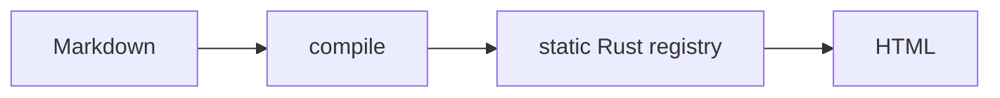

Write a `mermaid` fence and the block is marked for diagram rendering instead of syntax highlighting.

````mdx filename="content/pipeline.mdx"

````

## Configuring it

```rust filename="build.rs"
use proa_docs_build::{Config, MermaidConfig};

let config = Config::new().source(source.markdown(pipeline.mermaid(MermaidConfig::new())));
```

| Option | Meaning |
|---|---|
| `enabled` | Turn Mermaid handling on |
| `code_fences` | Treat ```` ```mermaid ```` fences as diagrams |
| `renderer` | Recorded for a future renderer; the emitted markup is the same for every value today |
| `fallback` | What to show when rendering does not happen |

The build emits the diagram source in a hidden `data-proa-docs-mermaid-source` block and an empty output slot in `data-proa-docs-mermaid-output`, then leaves rendering to a script you ship.

<Callout type="warning">
`proa_docs` does not currently ship a Mermaid renderer. The build emits the
source and the slot; supplying a renderer is yours. Until you do, the figure
is blank with scripting on, and the `<noscript>` fallback appears only when
JavaScript is disabled.
</Callout>

## Diagram or picture?

Mermaid is right for anything with a decision or a sequence — it lives in git, needs no design time, and survives refactoring. For a conceptual diagram where the layout *is* the explanation, a hand-authored SVG beats Mermaid's auto-layout every time.

## Related

[Code block](/docs/proa-docs/code-block) · [Math](/docs/proa-docs/math) · [Configuration](/docs/proa-docs/configuration)
